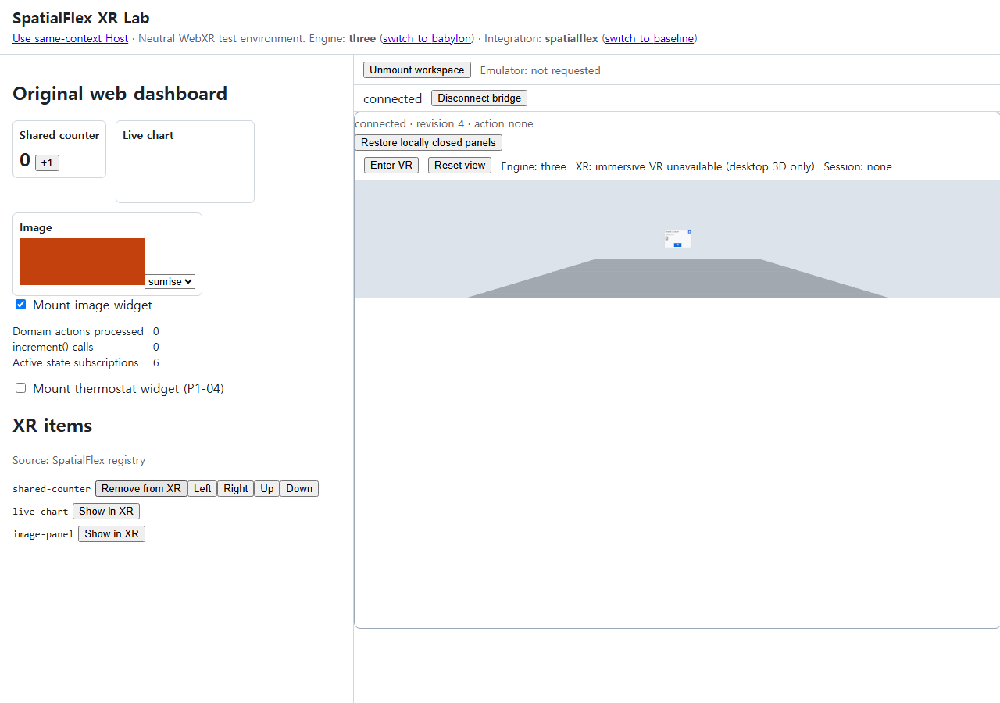
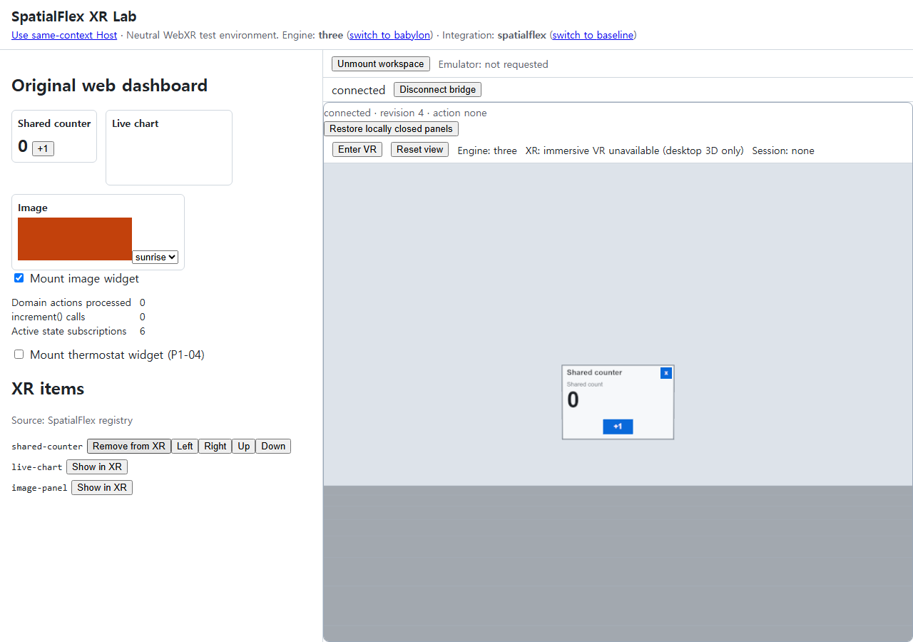
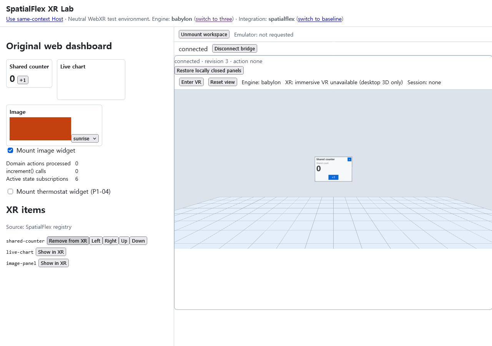
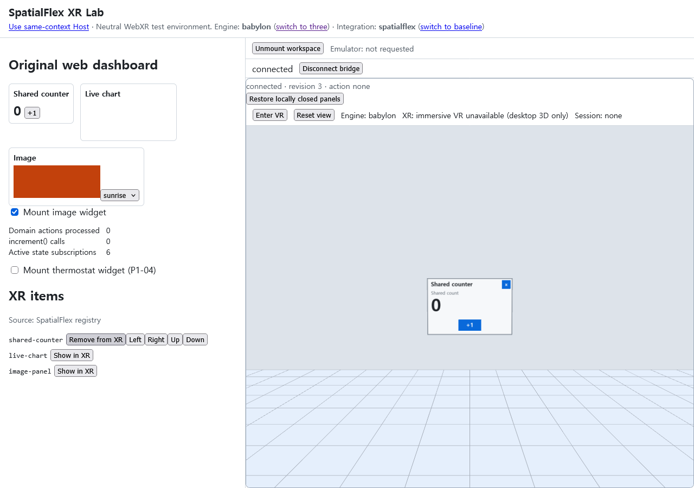

# Cross-host iframe layout correction

The independent XR Host now fills the available workspace in Three.js and Babylon.js. This correction changes only `host.html` and scoped layout CSS; the parent/iframe bridge, protocol, authorization, leases, registration ownership and semantic action handlers are unchanged.

## Cause and correction

The parent hierarchy is `.lab` (viewport-height column) → `.lab-columns` (flex remainder) → `.lab-right` (column) → workspace toolbar → `.bridge-host` → connection toolbar + `.bridge-frame`. Previously `.bridge-host` was an ordinary block, and the inline iframe had a fixed 660px content height. Its border also added width outside the parent's available width.

Inside the independent document, `html`/`body`/`#root` had no definite height. The same-context `.lab-right > .xr-host` flex rule cannot match that document. Consequently the Three.js canvas fell back to 150px, while Babylon's intrinsic canvas proportions produced a different but still undersized height.

The bridge section is now a growing column, and its block-level iframe consumes the space after the connection toolbar with border-box sizing. A dedicated `xr-iframe-document` class establishes a 100% `html`/`body`/root height chain, a column root and a growing Host with `min-height: 0`. Connection/status controls retain their natural heights; the restore button uses `align-self: flex-start` to avoid column cross-axis stretching. The existing engine canvas fill and ResizeObserver behavior then receive definite space. No fixed canvas/iframe height, JavaScript sizing workaround or change to the same-context selector is needed.

## Captured geometry

These observations use a 1280×900 desktop viewport, the actual registered Shared Counter mirror, production assets with the existing read-only test probe, and baseline `27732a1` before the correction. Values are CSS pixels; iframe sizes include their borders, roots/canvases do not.

| Browser / engine      | Iframe before → after | Root before → after | Canvas before → after | Unused below iframe before → after |
| --------------------- | --------------------- | ------------------- | --------------------- | ---------------------------------- |
| Chromium / Three.js   | 662 → 757             | 233 → 755           | 150 → 670             | 95 → 0                             |
| Chromium / Babylon.js | 662 → 757             | 497 → 755           | 414 → 670             | 95 → 0                             |
| Firefox / Three.js    | 662 → 756             | 234 → 754           | 150 → 667             | 94 → 0                             |
| Firefox / Babylon.js  | 662 → 756             | 498 → 754           | 414 → 667             | 94 → 0                             |

Afterward, both root scroll heights equal the iframe viewport. The parent scroll height equals its 900px viewport. Restore width is 188.64px Chromium / 179.73px Firefox within an 825px content width. Remaining iframe space is occupied by real status and Host toolbars.

[Raw before geometry](evidence/iframe-layout/before.json) · [Raw after geometry](evidence/iframe-layout/after.json). All four browser/engine screenshots are committed beside the JSON.

| Before                                                                             | After                                                                                    |
| ---------------------------------------------------------------------------------- | ---------------------------------------------------------------------------------------- |
|  |     |
|      |  |

## Verification and reproduction

`apps/xr-lab/e2e/layout.spec.ts` adds 16 browser cases: both engines × baseline/SpatialFlex integrations × same-context/iframe × Chromium/Firefox. Each exercises 1280×900, 1100×760 and 1600×1050 on the same live page. Assertions measure iframe-to-workspace height, root-to-viewport height, canvas-to-remaining-Host height, natural restore width, bottom gaps, backing-buffer resize and parent/iframe scroll extents. Each resize is followed by a real mouse click on the raycasted 3D counter button and an exact parent action-count assertion. The same-context cases also verify full height and working pointer actions after resizing. Existing tests are unchanged.

Focused command: `pnpm --filter @spatialflex/xr-lab exec playwright test e2e/layout.spec.ts` — PASS, 16 tests, Chromium and Firefox (1.3 minutes).

For the user-facing demo, run `pnpm install --frozen-lockfile`, then `pnpm dev:xr-lab --host 127.0.0.1 --port 5174`. Open `http://127.0.0.1:5174/?bridge=iframe&engine=three&integration=spatialflex&xr-emulator=off`, show the counter/chart in XR and resize the window. Change `engine=three` to `engine=babylon` to repeat.

To regenerate current screenshots/geometry in PowerShell:

```powershell
$env:VITE_XR_LAB_TEST_HOOKS='1'
pnpm build
pnpm --filter @spatialflex/xr-lab preview --host 127.0.0.1 --port 4180 --strictPort
# In another terminal at the repository root:
node apps/xr-lab/scripts/capture-layout-evidence.mjs after
```

The capture script can also label a server running the original baseline as `before`. It records computed display/flex styles and bounding boxes without modifying the page's layout. Production builds do not expose the probe unless explicitly enabled for testing.

Full regression validation and remote CI results are recorded in the PR. No physical headset or immersive iframe WebXR behavior is claimed by this desktop layout correction.
