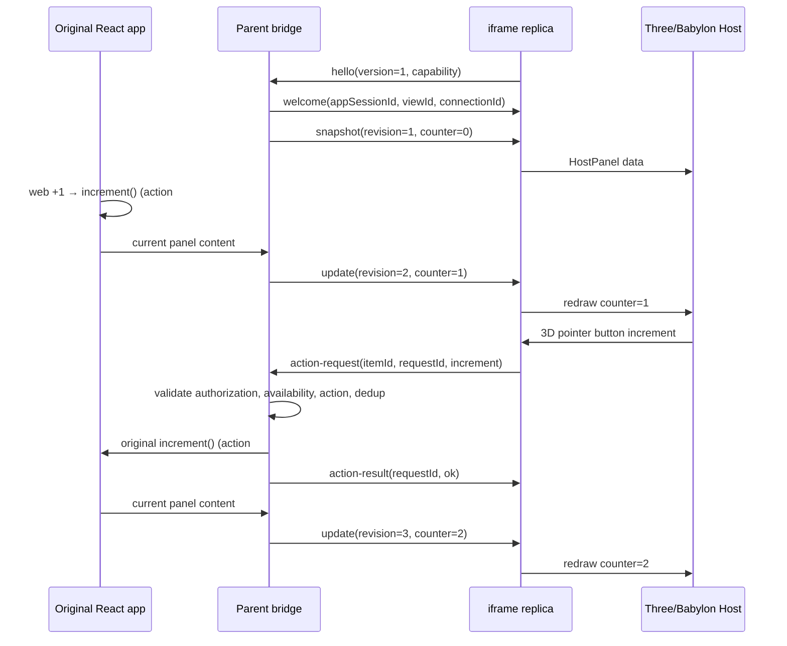

# P1-03: Cross-Context Live Bridge

This is a working **Cross-Context XR Mirror**, with the original React app as
the only domain authority. It does not transfer React components or DOM into XR.
Related design issue: [#7](https://github.com/ppsssj/SpatialFlex/issues/7).

Run `pnpm dev:xr-lab`, then open
`http://localhost:5173/?bridge=iframe&integration=baseline&engine=three`.
Select **Show in XR** for the counter, click the web +1, and click the 3D +1.
Both views show 2, and both domain diagnostics show exactly two increments.
Use `integration=spatialflex` or `engine=babylon` for the other combinations.
Omitting `bridge=iframe` preserves the existing same-context lab.

## Boundaries and state ownership

| Owner              | State and responsibility                                                                      |
| ------------------ | --------------------------------------------------------------------------------------------- |
| Original app       | `LabStore`, domain actions, domain diagnostics, mounted widget lifecycle                      |
| Parent integration | Eligibility, which items to publish, initial panel placement and parent presentation controls |
| Parent bridge      | Authorization, app session, connection lease, revisions, bounded action ledger                |
| iframe replica     | Disposable serialized panel content, last accepted revision, pending requests                 |
| iframe Host        | Camera/orbit/XR state, selection, locally closed panels, hover and engine resources           |

`host.html` has its own module entrypoint (`src/bridge/host-main.tsx`) and JavaScript
realm. It imports renderer contracts, protocol/replica code and the selected
engine. It does not import the fixture, parent store, integration or SpatialFlex.
Neither React Context nor component instances cross this boundary. Both engines
consume the existing renderer-neutral `HostPanel`/`HostEvents` contracts unchanged.
Host events become semantic action requests; only the parent invokes the original
integration callback. Local selection/close operations never invoke domain actions.

## Protocol v1 schemas

The executable, strict schema is `apps/xr-lab/src/bridge/protocol.ts`.
Every object has exactly the listed keys. Unknown keys and message types fail
validation; the boundary never evaluates transmitted content.

Every message includes this envelope:

```ts
type Envelope = {
  protocolVersion: 1;
  appSessionId: string; // fresh UUID for the lifetime of the parent app module
  viewId: string; // fresh UUID for each mounted iframe Host
  connectionId: string; // parent-issued UUID, rotated on every accepted hello
  revision: number; // nonnegative safe integer; parent owns state revisions
};
```

| `type`           | Additional fields                                   | Direction / meaning                                                          |
| ---------------- | --------------------------------------------------- | ---------------------------------------------------------------------------- |
| `hello`          | `capabilities: string[]`                            | iframe → parent; requests `host-panels-v1`; connectionId initially `pending` |
| `welcome`        | `capabilities: string[]`                            | parent → iframe; confirms capability and issues connectionId                 |
| `snapshot`       | `panels: HostPanel[]`                               | parent → iframe; initial/reconnect/periodic full replacement                 |
| `update`         | `panels: HostPanel[]`                               | parent → iframe; revisioned full replacement after content change            |
| `register`       | `itemId: string, panels: HostPanel[]`               | parent → iframe; publication adds a panel                                    |
| `unregister`     | `itemId: string, panels: HostPanel[]`               | parent → iframe; publication removes a panel                                 |
| `action-request` | `itemId: string, requestId: string, action: string` | iframe → parent; an opaque panel button ID, no executable payload            |
| `action-result`  | `itemId: string, requestId: string, status`         | parent → iframe; status is `ok`, `denied`, `capacity` or `conflict`          |
| `ping` / `pong`  | none                                                | parent → iframe / iframe → parent; connection lease                          |
| `resync`         | none                                                | iframe → parent; requests full snapshot                                      |
| `disconnect`     | none                                                | either direction; revokes local connection immediately                       |

`HostPanel` is `{id, title, position: [x,y,z], body, buttons, selected}`.
`body` is exactly one of `{kind: "value", label, value: string}`,
`{kind: "bars", label, values: number[]}`, or
`{kind: "swatch", color: "#rrggbb", caption}`.
Each button is `{id, label}`. Numeric data must be finite; strings have a
256-character bound (value may be empty), panel/button IDs must be unique, and
arrays are bounded to 32 panels, 8 buttons, 64 bar values and 8 capabilities.
No functions, DOM nodes, React components, HTML or arbitrary code are accepted.

Registration concerns published XR representations. The complete eligible item
catalog remains in the parent integration. Unshown items cannot receive actions.
Each state message includes the complete current panel set, even when its type
names a registration transition. If a commit changes several items, `itemId`
identifies one transition and `panels` is authoritative for all of them.

## State sequences



Revisions in this diagram are illustrative: resyncs and periodic snapshots also
advance the parent revision, including when domain content has not changed.
An ActionResult acknowledges processing; the subsequent state message is the
rendering authority. A rejected or unrecognized result does not change content.

```mermaid
sequenceDiagram
    participant Parent as Parent bridge
    participant Frame as iframe replica
    Frame->>Parent: action-request(requestId=A)
    Parent->>Parent: reserve A, invoke original action once, store result
    Parent--xFrame: action-result(A) lost
    Frame->>Parent: retry A (same item/action)
    Parent->>Frame: replay stored result, no action invocation
    Parent--xFrame: disconnect lost
    Note over Frame: lease expires; stale status; no interactive panels
    Frame->>Parent: hello (only accepted if parent enabled)
    Parent->>Frame: welcome(new connectionId)
    Frame->>Parent: resync
    Parent->>Frame: snapshot(latest revision, full current state)
```

## Lifecycle, disconnection and reliability

1. Mount installs one parent protocol listener and heartbeat interval. A new
   iframe boots its independent Host and sends hello immediately, then every
   500 ms until a welcome and full snapshot arrive.
2. Both sides require exact origin, exact Window source, protocol, appSessionId
   and viewId. The parent negotiates `host-panels-v1` and issues a connectionId.
   Subsequent messages must carry this connection identity.
3. Every content change publishes a new revision. Replicas accept only revisions
   greater than their last accepted revision; older and duplicate state messages
   cannot overwrite state. State messages are full replacements so gaps are safe.
4. The parent sends ping and a fresh full snapshot every 500 ms. This repairs
   dropped updates/unregistrations without a patch log. The iframe returns pong.
   Each side expires authorization after 2500 ms without the expected peer
   traffic. The replica also expires state freshness after 2500 ms without a newer
   full state message, even if pings still arrive; stale content cannot remain
   interactive indefinitely. Browser timer throttling may produce a safe stale/reconnect cycle.
5. Disconnect clears iframe pending requests, removes interactive panels and
   displays **stale / disconnected**. A locally expired lease also blocks sending
   actions before the next rendered frame. The parent checks its own lease on
   each request, and rejects stale connection IDs. An explicit parent Disconnect
   removes its receiver and timer; hello retries cannot restore authorization
   until the user chooses Reconnect.
6. Reconnect rotates connectionId, sends a newer full snapshot, and restores
   the latest web state. Requests cleared at disconnect are not automatically
   recreated: after an ambiguous lost response, the user observes resynced state.
   Iframe reload also handshakes; a workspace remount receives a new viewId.
7. Cleanup sends best-effort disconnect, removes message/pagehide listeners,
   clears intervals and pending requests. Removing the iframe disposes its realm
   and engine; existing same-context Host teardown is unchanged. No MessagePorts
   are used. The parent bridge introduces no store subscription of its own.

### Idempotency guarantee and limits

The parent ledger reserves `requestId` across the entire app session before
invoking a synchronous domain callback. It stores the view/item/action fingerprint
and result. A retry replays the result; reuse from a different view or for a
different item/action returns `conflict`, including after workspace remount. Unknown or
unavailable items and undeclared actions return `denied`. Even failures after a
possible mutation are recorded and never automatically reexecuted.

Records survive iframe reloads, disconnects and workspace remounts within the
parent app session. At most **1024 requests** (including rejections) are retained.
Records are never evicted: after capacity is reached, new requests return
`capacity`; recorded requests can still retrieve their results. Reloading the
original app starts a fresh store and app session. The iframe bounds pending
requests to 32 and retries every 500 ms while authorized.

This is at-most-once callback invocation for a request ID within the supported
in-memory session. Successful delivery plus retries is tested to yield exactly
one increment per XR request. There is no durable exactly-once guarantee across
parent crashes/reloads, no distributed transaction, and no guarantee of delivery
under permanent message loss. New request IDs denote new user actions.

## Security assumptions

All sends specify `location.origin` as targetOrigin. Both receivers check
`event.origin` **and** `event.source` before schema validation. The parent checks
the source against its exact iframe Window, and the iframe against its parent.
IDs in the iframe URL fragment identify the intended app/view; they are not
cryptographic authentication credentials. The rotating connection ID rejects
requests from expired connections. Capability negotiation is an allowlist, not
a grant to call arbitrary functions. Item and button availability are checked
against current published panels, and the integration rechecks mounted/shown
items before calling the fixture action.

This MVP assumes trusted same-origin application and iframe code. A same-origin
iframe is a separate JavaScript realm, **not a hostile-code sandbox**; malicious
same-origin code or XSS could bypass application-level controls. Only deliberately
published panel data is transmitted. Deployments must decide which fields are
safe to disclose. There is no cross-origin authorization, user permission service,
tenant isolation, network authentication or confidential-data transport design.
The prototype uses neither parent property access nor window globals to exchange
application state. Existing read-only rendering diagnostics and test-only fault
hooks are used solely by browser tests.

## Baseline and SpatialFlex comparison

| Concern                   | Baseline                                      | SpatialFlex                                               |
| ------------------------- | --------------------------------------------- | --------------------------------------------------------- |
| Eligibility               | Manual `ALL_ITEMS` list                       | Actual `useSpatialItems()` Registry registrations         |
| Widget mount lifecycle    | Explicit `imageMounted` filtering             | Mounted `SpatialItem` registers/unregisters automatically |
| Unmount propagation       | Manual availability change prunes publication | Registry change prunes publication automatically          |
| Domain state/actions      | Original shared fixture                       | Same original shared fixture                              |
| Bridge, wire format, Host | Identical                                     | Identical                                                 |
| SDK download in baseline  | None (browser asset assertions)               | Lazy SpatialFlex integration chunk                        |

Both send the same serialized panel vocabulary and validate against the same
transport boundary. The Host contains no integration-specific optimization.
ESLint disallows fixture/integration/SDK imports anywhere in bridge code; browser
tests also verify that the iframe does not load app, fixture or integration chunks.

## Renderer and browser compatibility

Desktop cross-context 3D is exercised with Three.js **and** Babylon.js, baseline
and SpatialFlex, on Chromium and Firefox. Existing same-context desktop and IWER
immersive tests remain in the suite. The iframe loads only its selected engine;
the parent loads neither engine in bridge mode. WebXR-unavailable Hosts retain
their existing desktop rendering and capability/status toolbar.

Immersive **iframe** WebXR is not validated or promised in this milestone. The
iframe does not configure an explicit `allow="xr-spatial-tracking"` policy. Browser
permission policies, native hardware/runtime support and user gestures can reject
immersive entry; the existing Host displays the actual capability/error. The
parent's emulator is not installed inside the iframe. Use desktop mode as the
validated fallback. IWER same-context coverage is not evidence of iframe WebXR
or physical headset support.

## Milestone distinctions and unsupported capabilities

| Milestone                            | What it proves                                                                                                      |
| ------------------------------------ | ------------------------------------------------------------------------------------------------------------------- |
| P0 Same-Host Detach                  | Original React live contract within one host; same-host positioning/detach                                          |
| P1-00 / P1-02 Same-Context XR Mirror | Separate XR panel rendering of app state/actions; interchangeable Three/Babylon Hosts in the same execution context |
| P1-03 Cross-Context XR Mirror        | Independent iframe realm; versioned data/action bridge; parent authority, retries, resync and lifecycle             |
| Future Generalized Detach to XR      | Requires broader semantic view adapters, permissions, runtime/device validation and explicit cross-origin design    |

Unsupported: automatic React DOM transfer, arbitrary websites/widgets/components,
component/function/DOM serialization, app-free business actions, cross-origin
Hosts, asynchronous transactional actions, durable replay after crashes, native
headset claims and a generic SDK bridge API. The protocol remains an XR Lab MVP,
not a new public SpatialFlex package API.

## Architecture decision (P1-03)

Context: existing lab adapters already produce renderer-neutral serializable
panels and callbacks; the new requirement is an independent execution boundary.
Invariants: original app authority, renderer independence, comparable integrations,
no executable payload, bounded retries, and unchanged existing integration paths.

| Option                                            | Benefits                                                                                     | Costs / evidence                                                                                                |
| ------------------------------------------------- | -------------------------------------------------------------------------------------------- | --------------------------------------------------------------------------------------------------------------- |
| Window postMessage + full replacements (selected) | Small boundary; exact origin/source checks for every message; easy deterministic fault tests | Repeated bounded snapshots; trusted same-origin iframe assumption                                               |
| MessageChannel                                    | Dedicated channel; less global routing                                                       | Port transfer, replacement, cleanup and separate bootstrap validation add complexity without a requirement here |
| Shared store/context                              | Little code                                                                                  | Violates independent realm and original ownership requirements                                                  |

Decision: wrap the existing Host contract with a parent authority and independent
iframe replica. Use postMessage, a rotating connection identity, monotonic full
replacements, leases, and a fail-closed bounded ledger. Trade-off: periodic full
snapshots cost more bandwidth than patches, but this three-panel fixture needs
no patch ordering or retained revision log. Capacity exhaustion intentionally
requires starting a new parent app session. Migration is opt-in via URL and
introduces no public Core/React API changes.

Verification: strict schema/ledger/revision unit contracts, real 3D browser
interactions, deterministic dropped/duplicate/reordered messages, identity and
lease rejection, remount cleanup, asset isolation and the complete preexisting
suite. See [verification evidence](live-bridge-verification.md) for fresh results.
