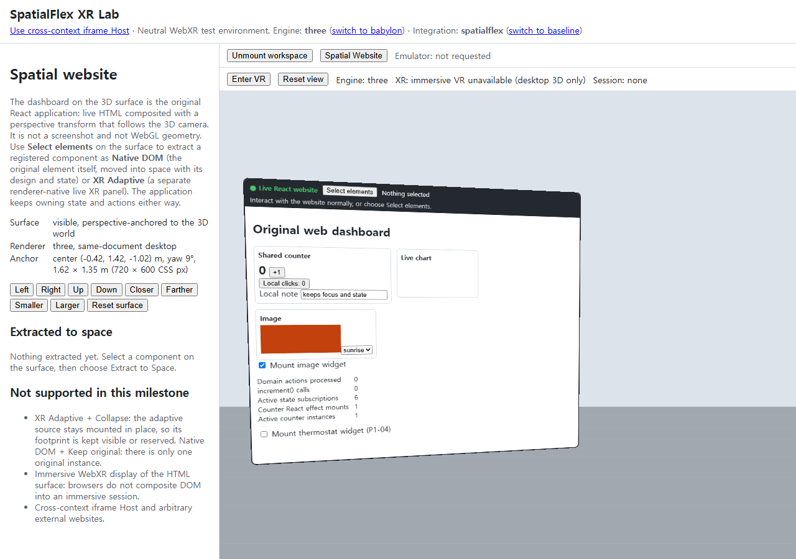
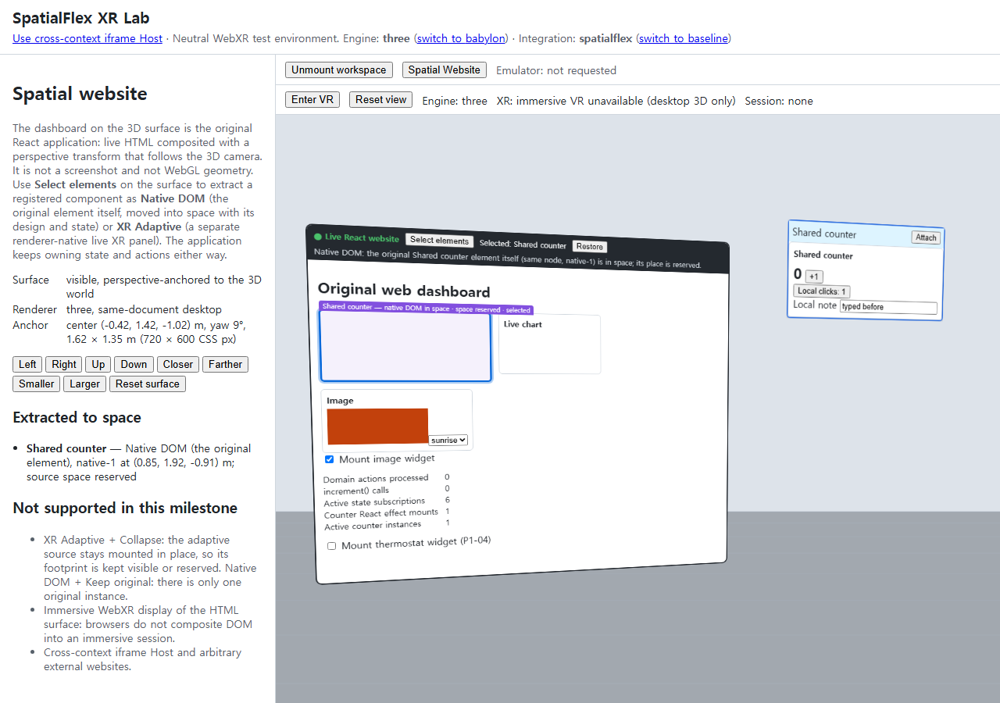
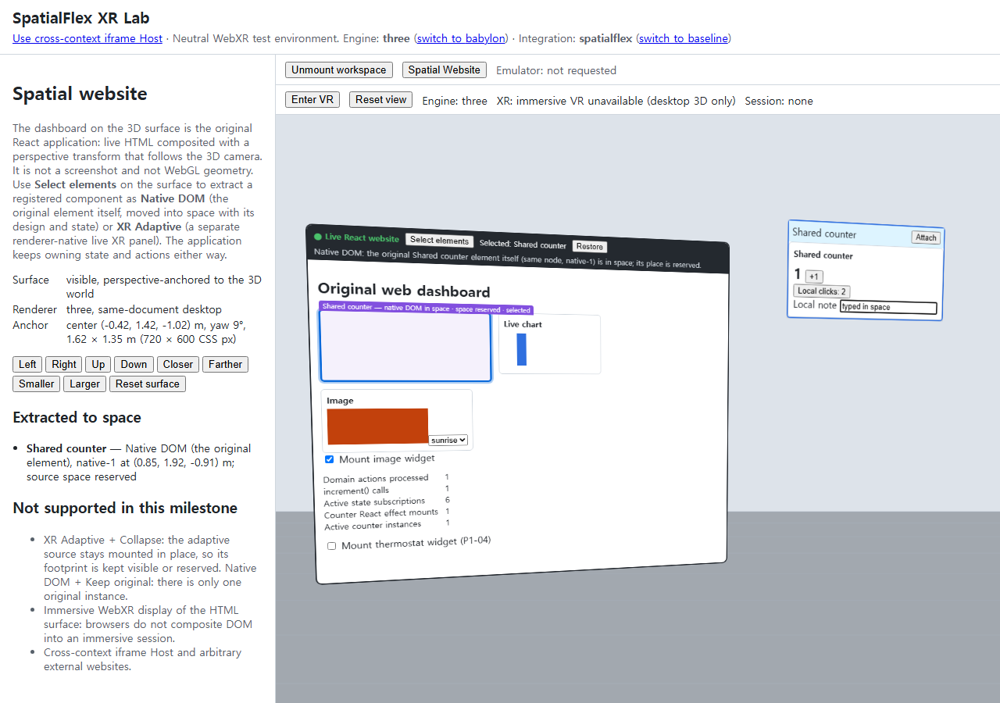
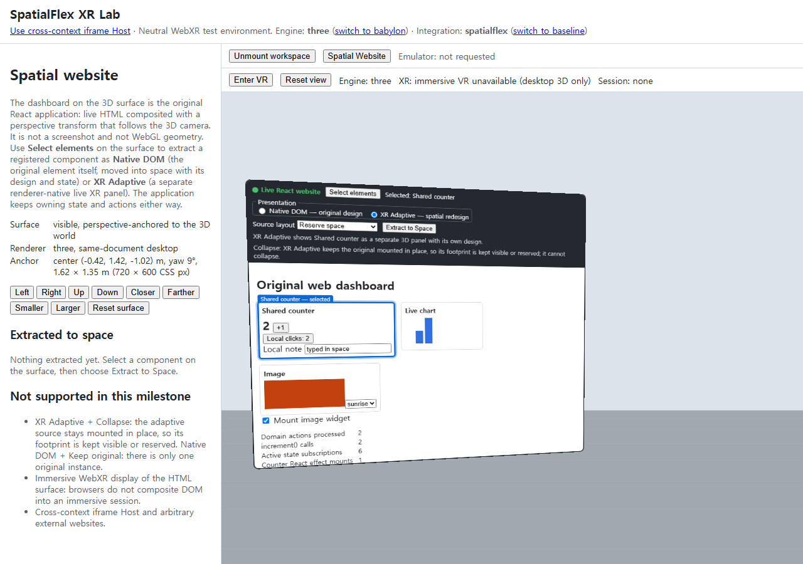
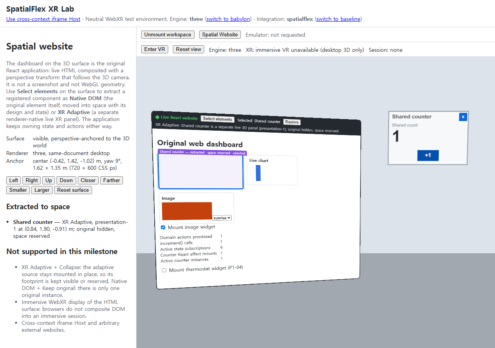
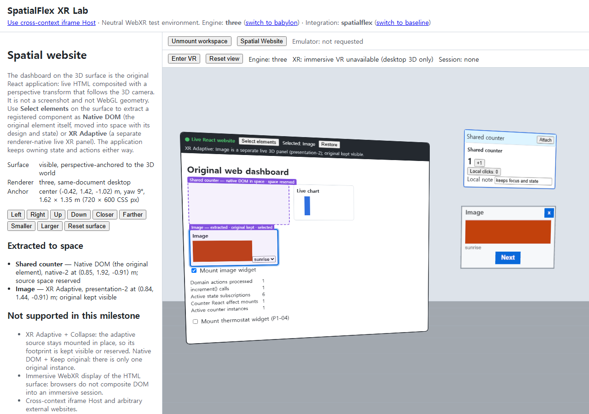

# P1-06A Native DOM Spatial Extraction and Presentation Strategies

Status: **experimental, desktop proof of concept.** This is a follow-up to P1-06 ([#22](https://github.com/ppsssj/SpatialFlex/issues/22), [spatial web surface](spatial-web-surface.md)).

SpatialFlex now lets a user choose, per extraction, between two **presentation strategies**:

|                       | **Native DOM** — original design                                                     | **XR Adaptive** — spatial redesign                           |
| --------------------- | ------------------------------------------------------------------------------------ | ------------------------------------------------------------ |
| What appears in space | The original mounted element itself: same DOM node, same React instance              | A separate renderer-native panel built from `SpatialItem xr` |
| Rendered by           | The browser's HTML compositor (CSS 3D), same document                                | Three.js or Babylon.js (WebGL)                               |
| Design                | Original HTML/CSS                                                                    | XR design (value, bars or swatch, plus semantic buttons)     |
| Interaction           | The original buttons, inputs and selects, with their handlers, focus and local state | Declared semantic actions, invoked in the application        |
| Application state     | Unchanged: the component is still the same subscriber                                | Shared: the parent-owned store and actions                   |
| Source layout         | Reserve space (placeholder) or Collapse                                              | Keep original or Reserve space                               |
| Immersive WebXR       | **Not shown.** Browsers do not composite DOM into immersive sessions.                | Shown (existing XR Mirror)                                   |
| Requires              | `detachable` and a same-document DOM compositor host                                 | A declared `xr` view                                         |

The **presentation strategy** (how the component is presented) and the **source layout policy** (what happens to its original place) are separate, independent types.

## 1. Feasibility (Phase 1): what was rejected, with evidence

| Approach                                                                 | Result                                                                                                                                                                                                                              | Evidence                                                                      |
| ------------------------------------------------------------------------ | ----------------------------------------------------------------------------------------------------------------------------------------------------------------------------------------------------------------------------------- | ----------------------------------------------------------------------------- |
| React portal to a spatial container                                      | **Rejected.** Changing the portal target remounts the subtree: new node, local state lost, mount count 2.                                                                                                                           | `packages/react/src/feasibility.test.tsx` (reproduces it)                     |
| Re-parenting the React-owned node with `appendChild`                     | **Rejected.** React still believes the node is in its old parent, so the next reconciliation throws (`removeChild … not a child`).                                                                                                  | Same file (reproduces the exception)                                          |
| Cloning the DOM or JSX into a second root                                | **Rejected by requirement.** It duplicates instances and state.                                                                                                                                                                     | —                                                                             |
| Plain `position: fixed` inside the surface                               | **Insufficient.** The surface page has a `matrix3d` transform, so it becomes the containing block for fixed descendants. The element stays in the page plane. The page's `overflow: hidden` and occlusion `clip-path` also clip it. | Browser behavior per CSS Transforms spec; addressed below                     |
| **Keep the node in place; cancel the parent transform with its inverse** | **Adopted**                                                                                                                                                                                                                         | `surfaceMath.test.ts` (math against Three.js); `e2e/native.spec.ts` (browser) |

## 2. Architecture: DOM ownership and presentation ownership

**React keeps owning the DOM.** The extracted element never leaves its React position: the `SpatialItem` panel element inside the page, inside the dashboard. Nothing is moved, cloned, portaled or remounted. Only the panel element's **presentation** changes, and that is split between two owners:

1. **SpatialFlex React (`SpatialItem` + controller)** owns the detach state. This is P0 Move reused: status `detached`, placeholder or collapse, the SDK panel bar with **Attach**. A new **placement** value (`viewport` for P0 Move, `external` for Native) says who positions the panel. With `external`, `SpatialItem` renders `position: fixed; left: 0; top: 0; transform-origin: 0 0`, at the original content width, and disables viewport drag and resize.
2. **The DOM compositor** (`apps/xr-lab/src/surface/useSurfaceCompositor.ts`) owns the panel's `transform`, `clip-path` and `visibility`. It writes them per camera frame, outside React, and removes them before paint on restore or unmount.

### Transform and clipping

Because the page is transformed, it is the containing block of the fixed panel: the panel's box starts at the page's padding-box origin (border-box offset `b`). The browser composes the page's transform `H_page` with the panel's own transform `T`. SpatialFlex sets

```text
T = translate(-b) · H_page⁻¹ · H_panel
⇒ H_page · translate(b) · T = H_panel
```

`H_panel` is the homography of the panel's **own world pose**: its position and rotation, with size = layout pixels × the surface's meters-per-pixel. The parent's world transform is cancelled by its inverse, so the same node is projected at an independent pose and follows camera orbit, reset and resize exactly. A unit test composes the two matrices and compares the result with Three.js's own projection to 3 decimal places. The browser applies the perspective division, and hit testing inverts the composed matrix, so native input works.

Clipping:

- **Page `overflow`** is now `visible`. The chrome bar and viewport carry their own radii.
- **The viewport's scroll clip (`overflow: auto`)** does not apply: per CSS, overflow clips descendants only when the clipping box is in their containing-block chain. The panel's containing block is the page, outside the scroller.
- **`clip-path` clips all descendants**, so the page's occlusion clip becomes a nonzero `path()`: the page rectangle, minus holes for 3D panels in front, **united with the native panel's footprint** in page coordinates.
- **Depth:** a native panel in front of the page plane paints above it (it is a positioned descendant). If it is behind the page plane, its own `clip-path` removes the page's area, so the page covers it. 3D (adaptive) panels in front of a native panel are cut out of it the same way.
- The panel's facing and camera-plane checks hide it from behind. If the panel would cross the page plane's horizon (mixed homogeneous signs), it is reported as _unmappable_ and hidden.

### Instance preservation

- The node never changes parent: the E2E compares retained element references for the article, button, input and local button before, during and after extraction, and checks that exactly one `web-count` exists.
- React state, context and subscriptions are untouched. The fixture's diagnostics show React effect mounts 1, active instances 1, and active and cumulative subscriptions unchanged.
- The design is unchanged: computed font, color, background, border, radius, padding and width are identical before, during and after extraction. The content keeps its fractional original width because the panel uses `content-box` with the measured layout width.

## 3. SDK API

```tsx
// Native by default: no XR view needed.
<SpatialItem id="counter" detachable presentation="native">
  <Counter />
</SpatialItem>

// Adaptive by default (also the default whenever `xr` is declared,
// so existing code keeps its behavior).
<SpatialItem
  id="counter"
  detachable
  presentation="adaptive"
  xr={{
    title: "Counter",
    body: { kind: "value", label: "Count", value: String(count) },
    actions: [{ id: "increment", label: "+1", invoke: increment }],
  }}
>
  <Counter />
</SpatialItem>
```

`presentation` declares the **default**. A user can still choose either strategy per extraction when both are available.

Core (`@spatialflex/core`):

- `PresentationStrategy = "native" | "adaptive"` and `ExtractionSource = "visible" | "reserved" | "collapsed"`.
- `validateExtraction(request, { detachable, hasView, nativeHost })` gives explicit acceptance or rejection with a reason:
  - Native + Keep original is rejected: there is one original instance.
  - Adaptive + Collapse is rejected: the source stays mounted in place.
  - Adaptive without `xr` is rejected.
  - Native without `detachable`, or without a DOM compositor host, is rejected.
- `presentationSupport`, `defaultPresentation(declared, hasView)`, `assertExtraction`.
- `registration.setPresentation(...)` and `registry.presentationOf(id)`: scoped to the registration, removed on unregister, and ignored from stale handles. The record shape is unchanged.

React (`@spatialflex/react`):

- `SpatialItem presentation` prop, validated without coercion.
- `controller.extractNative(id, "placeholder" | "collapse")`, `controller.placement(id)` (`"viewport" | "external" | null`) and `controller.nativeElement(id)`. These cover registered, natively extracted items only.

Identity stays separate: logical `itemId`, `registrationId`, the **presentation instance id** (`native-N`, `presentation-N`), the bridge `viewId`, and the **strategy** (`native` or `adaptive`).

## 4. Supported environments

| Host                               | Native DOM                               | XR Adaptive               |
| ---------------------------------- | ---------------------------------------- | ------------------------- |
| Three.js, same document, desktop   | ✅                                       | ✅                        |
| Babylon.js, same document, desktop | ✅                                       | ✅                        |
| Cross-context iframe Host          | ❌ Spatial Website disabled, with reason | ✅ (XR Mirror, unchanged) |
| Immersive WebXR session            | ❌ DOM is not composited into XR         | ✅                        |

Leaving Spatial Website or unmounting the workspace returns native extractions to their place, because no compositor is left to position them.

## 5. Demo

```bash
pnpm install --frozen-lockfile
pnpm --filter @spatialflex/xr-lab dev --host 127.0.0.1 --port 5173 --strictPort
```

Open **http://127.0.0.1:5173/?integration=spatialflex&engine=three&bridge=off&surface=website**. `engine=babylon` works the same way.

1. Click **Select elements**, then click **Shared counter**.
2. Choose **Presentation: Native DOM — original design**. **Source layout: Keep original** is disabled, with the reason shown.
3. Click **Extract to Space**. The original Counter, in its own design, moves beside the website.
4. In that panel, click `+1` and type in **Local note**. These are the original controls.
5. Click **Restore** (or the panel's **Attach**). It returns to its place with its state.
6. Select the Counter again, choose **XR Adaptive — spatial redesign** and **Extract to Space**. The 3D semantic mirror appears; its `+1` updates the same state.

## 6. Evidence

|                                                         |                                                  |
| ------------------------------------------------------- | ------------------------------------------------ |
| Original website                                        |           |
| Native DOM extraction                                   |             |
| Native input (local note typed, local clicks 2)         |        |
| Native restored                                         |  |
| XR Adaptive extraction                                  |         |
| Comparison: Counter as Native DOM, Image as XR Adaptive |     |

Records: `evidence/p1-06a-{three,babylon}-{chromium,firefox}.json`.

**Browser tests** (`apps/xr-lab/e2e/native.spec.ts`, 7 scenarios × Chromium and Firefox):

1. Native extraction for both engines: same nodes and one instance; unchanged mounts, instances and subscriptions; identical computed design; reserved footprint and unchanged neighbor; placement within 2 px of the renderer's own projection of the world pose; outside the surface's area; real `+1`, local button, keyboard typing and focus; orbit, reset and two viewport sizes; restore with identity, design, layout and state preserved.
2. Native ↔ Adaptive on the same Counter for both engines: unsupported options are disabled with reasons; the adaptive 3D `+1` runs exactly once; a side-by-side comparison; identity and diagnostics are preserved.
3. Native + Collapse: the source becomes `display: contents`, neighbors reflow, and restore returns the exact layout.
4. Depth: in front of the page, the panel is hit-tested and typed into over the page; behind it, the page covers it.
5. Lifecycle: unmounting a natively extracted Image removes the extraction, and remount gives a fresh attached registration. Three cycles create three distinct presentation instances with no leaks (textures, subscriptions, mounts). Leaving the mode restores the original.

Unit tests:

- Core `presentation.test.ts`: the full strategy × source matrix, malformed input, defaults, and registration scoping.
- React `nativeExtraction.test.tsx` and `feasibility.test.tsx`.
- `surfaceMath.test.ts`: transform composition and depth reporting.

Results of the full suite are recorded in the PR.

**Performance.** Per frame, for each native panel: one layout read (`offsetWidth` and `offsetHeight`), two 3×3 homographies and one inverse, and style writes only when values change. React does not re-render per frame. Bundle impact is recorded in the PR.

## 7. Limitations

- Desktop CSS 3D only. Native DOM is never rendered inside an immersive WebXR session; use XR Adaptive there.
- Depth is approximated per plane (page and panels): there is no per-pixel depth between DOM and WebGL. Intersecting planes are not resolved.
- In selection mode the page content, including a native panel, is `inert`. A collapsed native source has no outline, so restore it with the panel's **Attach** control.
- Native panels are not draggable in space yet (P0 viewport drag is disabled while externally placed). Their pose is fixed at extraction.
- CSS limits from P0 still apply: a component that relies on ancestor-dependent CSS (for example `:has()` on its parent, or container queries on an ancestor) may change appearance at the content width. The fixture's widgets were verified unchanged.
- One presentation per item at a time.

Follow-up: in-space manipulation of native panels, a shared pose and grab contract for native and adaptive panels, and an iframe-capable surface.
