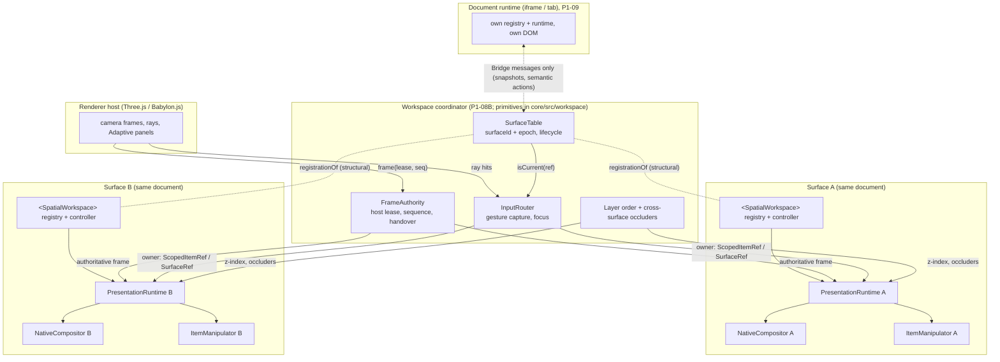

# P1-08A — Multi-Surface Workspace Architecture & Contracts

Tracking issue: #40. Baseline: `main` @ `a697289b2919cdace6a9387dd79e7cd53e96efb9`
(433 unit/integration, 396 browser E2E, package smoke passing).

**What this milestone is, and is not:**

- **Is:** architecture, ownership rules, small executable contracts and
  browser feasibility evidence for placing several independent web Surfaces
  in one spatial Workspace.
- **Is not:** a Multi-Surface feature. P1-08B implements it.
- **Public API:** nothing user-facing changes. The new primitives are
  package-internal to `@spatialflex/core`.

**Decision records:**

- [ADR 0001 — runtime ownership](adr/0001-multi-surface-runtime-ownership.md)
- [ADR 0002 — composition and occlusion](adr/0002-multi-surface-composition-and-occlusion.md)

**Evidence:** [`docs/evidence/p1-08a/`](evidence/p1-08a/): spike records and
screenshots, Chromium and Firefox.

Statements are marked **observed** (measured in a browser or test),
**decided** (this milestone's choice) or **open** (not resolved).

## 1. Product scope and definitions

| concept                       | definition                                                                                                                                                                                                                                                                                                       | today's code                                                                                                               |
| ----------------------------- | ---------------------------------------------------------------------------------------------------------------------------------------------------------------------------------------------------------------------------------------------------------------------------------------------------------------- | -------------------------------------------------------------------------------------------------------------------------- |
| **Workspace**                 | The shared spatial scene. It owns the world convention, the live Surfaces, renderer host authority, input ownership and focus, and layer ordering.                                                                                                                                                               | No equivalent yet. P1-08B adds a coordinator.                                                                              |
| **Surface**                   | A spatial representation of one application page or document. It has a stable `surfaceId`, a source owner, a world pose, a CSS size and local frame, a lifecycle, its registered items, a composition capability and an input boundary. Not the same thing as a React component, a tab, an iframe or a renderer. | The XR Lab's one `SpatialWebSurface` page. Its source scope is today's `<SpatialWorkspace>` (one registry and controller). |
| **Spatial Item**              | A developer-declared region of a source application (`SpatialItem`). Its id is unique within its Surface's registry.                                                                                                                                                                                             | `SpatialRegistry` record.                                                                                                  |
| **Presentation**              | One live spatial representation of an item: Native DOM or XR Adaptive. P1-07B2 semantics are unchanged.                                                                                                                                                                                                          | `PresentationRuntime` entry (`instanceId`).                                                                                |
| **Renderer Host**             | Three.js, Babylon.js or a future XR renderer. It draws the scene and supplies camera frames and rays. One host may display many Surfaces.                                                                                                                                                                        | `connectHost()` / `PresentationHost`.                                                                                      |
| **Document Runtime / Bridge** | Another JavaScript realm or document (iframe, tab). It takes part only through an explicit message protocol: its live DOM is never moved into or accessed from another document.                                                                                                                                 | The P1-03 live bridge (XR Mirror iframe, `postMessage`).                                                                   |

**Naming:** `<SpatialWorkspace>` (React) keeps its name for compatibility. In
the Multi-Surface model it is **one Surface's source scope**. The scene-level
Workspace is the new coordinator (ADR 0001).

## 2. Current single-surface architecture

```text
<SpatialWorkspace>  (registry + controller, one React subtree)
  └─ useSpatialPresentations → PresentationRuntime
        ├─ ItemManipulator (poses, sessions, selection)
        ├─ NativeCompositor (inline transform/clip of Native elements)
        └─ bindNativeHandles (pointer → ray via the runtime's last frame)
XR Lab: LabShell → useSurfaceCompositor (one page pose, one page clip)
        → runtime.connectHost({ drawsAdaptive: false }) as the page's Native host
        ThreeHost / BabylonHost → onCameraFrame → surface.onCameraFrame
```

## 3. Confirmed single-surface assumptions (audited source)

| #   | Assumption                                                                           | Where                                                         | Kind                                                                                                                       |
| --- | ------------------------------------------------------------------------------------ | ------------------------------------------------------------- | -------------------------------------------------------------------------------------------------------------------------- |
| 1   | One `#frame`                                                                         | `presentationRuntime.ts`                                      | Accidental for C1: correct as "the runtime's camera", since one host draws all Surfaces. A rendering constraint for C2/C3. |
| 2   | One `#frameSource`                                                                   | same                                                          | Ownership: authority without identity or expiry. Replaced at Workspace level by `FrameAuthority` (lease, epoch, sequence). |
| 3   | One `#surfaceElement`                                                                | same                                                          | Accidental: a runtime is per Surface in ADR 0001, so one containing page per runtime is correct.                           |
| 4   | First host that reports a frame is authoritative                                     | `connectHost().frame`                                         | Ownership rule. Kept as `FrameAuthority`'s compatibility default (tested A9).                                              |
| 5   | Other hosts' frames ignored                                                          | same                                                          | Correct. No stale-frame rejection by sequence: added in `FrameAuthority`.                                                  |
| 6   | `frame()` takes one `ContainingSurface`                                              | `HostFrameOptions.surface`                                    | Correct per runtime. The coordinator calls each Surface runtime's host with its own page.                                  |
| 7   | Registry rejects duplicate ids                                                       | `registry.ts`                                                 | Ownership constraint, kept: ids are unique per Surface registry (A1).                                                      |
| 8   | Presentations indexed by item id                                                     | `#entries`                                                    | Accidental at Workspace level: per-runtime is correct; the Workspace uses structured refs.                                 |
| 9   | Native handle rays use the runtime's one frame                                       | `bindNativeHandles(..., rayAt)`                               | Rendering constraint: correct for C1 (shared camera). For C2/C3 rays must come from the gesture's host lease.              |
| 10  | One `useSurfaceCompositor`                                                           | `LabShell.tsx`                                                | Accidental (Lab). P1-08B B2 makes it per Surface.                                                                          |
| 11  | One `SpatialWebSurface`, one page pose                                               | `LabShell.tsx`, `surfaceConfig.ts`                            | Accidental (Lab).                                                                                                          |
| 12  | Page clip assumes one transformed page                                               | `useSurfaceCompositor` occluders = this Surface's panels only | Rendering constraint: cross-surface occluders are needed (spike S6).                                                       |
| 13  | **Additional:** the authoritative frame never expires while its host stays connected | `#frame`                                                      | Ownership gap: handover must discard the old frame (`FrameAuthority.authorize`).                                           |
| 14  | **Additional:** instance ids are per runtime (`adaptive-1` in every runtime)         | `#generation`                                                 | Identity: the Workspace must not address presentations by instance id alone (A3 shows the collision).                      |
| 15  | **Additional:** a Native element stays in its page's stacking context                | `nativePanelTransform` design                                 | Rendering constraint: it cannot be painted above another Surface's layer without a hole there (spike S6).                  |

## 4. Runtime ownership alternatives

Summarized from ADR 0001:

- **Option A:** one registry, controller and `PresentationRuntime` per
  Surface, plus a Workspace coordinator.
- **Option B:** one runtime for every Surface.
- **Criteria:** identity, ownership, change size and compatibility, failure
  isolation, scene-level feasibility.

## 5. Selected architecture and rationale

**Decided: Option A (hybrid).**

- **Why:** facts 1–4 of ADR 0001 make per-Surface identity and DOM
  ownership free, and the single-surface code path unchanged.
- **The cost:** a coordinator for scene concerns, implemented and tested as
  primitives (§13).



The dashed Bridge edge is a message protocol. Nothing in the Workspace holds
a remote document's DOM, React tree or `HTMLElement`.

## 6. Identity and namespace rules

| identity                     | scope / uniqueness                                                                              | stable across                    | transport                                                       |
| ---------------------------- | ----------------------------------------------------------------------------------------------- | -------------------------------- | --------------------------------------------------------------- |
| `workspaceId`                | One coordinator instance. Not needed in-process; a Bridge namespace (= `appSessionId` of P1-03) | the Workspace's life             | string                                                          |
| `surfaceId`                  | Unique among LIVE Surfaces of a Workspace; chosen by the application                            | re-renders, Surface remounts     | string                                                          |
| `SurfaceRef.epoch`           | Assigned per `add`, never reused in a Workspace                                                 | — (one incarnation)              | number                                                          |
| `itemId`                     | Unique within one Surface's registry                                                            | re-renders, remounts             | string                                                          |
| `registrationKey`            | Unique across registries of one realm; never reused for a remount                               | re-renders only (new on remount) | string, meaningful only with its Surface (and document runtime) |
| `viewRegistrationId`         | View epoch of an Adaptive declaration (P1-07B2)                                                 | until the view is re-declared    | string                                                          |
| `presentationInstanceId`     | Unique per Surface runtime only                                                                 | one presentation                 | string, with its `ScopedItemRef`                                |
| `hostId` + `HostLease.epoch` | Host ids unique among connected hosts; epoch never reused                                       | one connection                   | —                                                               |
| `documentRuntimeId`          | P1-09: a remote realm's identity (P1-03 `appSessionId` + `connectionId`)                        | one realm session                | string                                                          |

**Rules (decided; tested A1, A2, A6):**

- **Structured references:** the Workspace addresses items with
  `ScopedItemRef { surface: { surfaceId, epoch }, itemId, registrationKey }`
  and presentations with `ScopedPresentationRef { item, instanceId }`.
  Equality compares every field; nothing is concatenated.
- **Revalidation:** every routed action or gesture is revalidated with
  `SurfaceTable.isCurrent(ref)`. The Surface incarnation must be live and
  its registry must still map `itemId` to `registrationKey`. The Surface's
  runtime then applies its own checks: the live instance and, for Adaptive,
  the view epoch (`invoke`).
- **What this rules out:**
  - An action of Surface A's `"chart"` cannot reach Surface B's `"chart"`
    (different `SurfaceRef`).
  - It cannot reach a remounted `"chart"` (new `registrationKey`).
  - It cannot reach a removed and re-added Surface A (new epoch).
- **Transport:** `encodeItemRef` produces the versioned JSON tuple
  `["sf-item/1", surfaceId, epoch, itemId, registrationKey]`, and
  `decodeItemRef` validates every field. A Bridge prefixes or wraps it with
  `documentRuntimeId`.

## 7. Coordinate-space definitions

**Decided:** keep the existing convention, which is right-handed, +y up, viewer
looking along −z, in meters.

| space                | definition                                                                                                                                                                                                                                                                                |
| -------------------- | ----------------------------------------------------------------------------------------------------------------------------------------------------------------------------------------------------------------------------------------------------------------------------------------- |
| 1. Surface CSS       | (u, v) CSS px from the page's top-left, v down. `resolution` = CSS layout size. DPR never enters: CSS pixels are the page's own unit, and the browser applies DPR when it rasterizes.                                                                                                     |
| 2. Surface local     | meters, origin at the page center, +x right, +y up, +z out of the page: x = (u − W/2)·mpp, y = (H/2 − v)·mpp, z = 0.                                                                                                                                                                      |
| 3. World             | world = position + R(rotation) · (scale · local). Order: scale, rotate, translate (the `SpatialTransform` order of `transformPoint`). Rotation is a unit quaternion; the DOM package's Euler XYZ `SpatialWebSurfacePose` converts through `quaternionFromEuler` (equal within 1e-12, A9). |
| 4. Clip              | `CameraFrame.viewProjection` (column-major, WebGL clip, y up).                                                                                                                                                                                                                            |
| 5. Viewport / client | `CameraFrame.viewport` is the canvas client rectangle in CSS px. x = left + (ndc.x + 1)/2 · width, y = top + (1 − ndc.y)/2 · height. The inverse is `viewportRay`.                                                                                                                        |

**Surface bounds:** u ∈ [0, W], v ∈ [0, H]. World size is W·mpp·scale ×
H·mpp·scale. `intersectSurface` reports `inside` and `front` (+z facing).

**Round trip (A4):** CSS → world → CSS within 1e-9 px for arbitrary
rotations and scales. A ray through a page point intersects at that point.

**Presentation placement policies:**

- **World-anchored (decided P1-08B default).** An extracted presentation's
  pose is a world pose in its Surface runtime's `ItemManipulator`. Moving
  the Surface does not move it.
  - This is the shipped semantics.
  - It avoids a second pose store.
  - It keeps a committed pose stable when the user rearranges Surfaces.
- **Surface-relative (later, opt-in):** a policy that, when the Surface
  moves, relocates the presentation's layout origin (`runtime.relocate`) by
  the Surface's delta. It is still one pose store, because `relocate` moves
  the origin and the manipulator keeps the user's delta on top.

## 8. Camera and host ownership

**Decided:** frames come from host leases, not from a global camera.
`FrameAuthority` (tested A7, A9):

**Lease and authority rules:**

- **Leases:** `connect(hostId)` returns a lease `{ hostId, epoch }`. Ids are
  live once; epochs are never reused.
- **Default authority:** when nobody is authoritative, the first lease that
  submits a frame becomes authoritative. This is today's runtime rule.
- **Handover:** `authorize(lease)` hands over explicitly and discards the
  previous frame. No Surface ever composites with another host's camera.
- **Stale frames:** each frame carries a per-lease sequence, and an older or
  equal sequence is rejected.
- **Disconnect:** disconnecting the authority clears authority and frame.

**Cases:**

- **C1, one host and many Surfaces (P1-08B):** one authoritative lease. Its
  frame is passed to every Surface runtime's host with that Surface's page,
  so all Surfaces share one camera and one ray convention.
- **C2, multiple hosts (future):**
  - Each host gets its own lease.
  - Native DOM composition uses the authoritative lease only, since one
    document has one DOM layout.
  - Input from a non-authoritative host is rejected.
  - Teardown ends that host's gestures (`InputRouter.hostEnded`).
- **C3, immersive XR (future):**
  - The XR host is a lease whose frames carry per-view cameras.
  - DOM composition stays on the desktop (non-stereo) frame. Stereo DOM
    composition is not designed here.
  - Controller rays are input from the XR lease.
- **Not designed:** a permanent global camera, multiple simultaneous DOM
  cameras.

## 9. Input, focus and pointer routing

**Decided (`InputRouter`, tested A5–A7):**

- **Inputs:** host lease, pointer id, and ordered geometric hits along the
  world ray. Each hit has an owner (Surface or presentation), a distance and
  an `interactive` flag.
- **Order:** nearest first. At coplanar distance (≤ 1e-4 m) a presentation
  ranks above its page; remaining ties use a stable key. The nearest hit
  decides: if it is not interactive, the gesture goes to **nobody**, so input
  never leaks behind an occluder (rule 2).
- **Capture:** the owner is fixed at pointer down for the gesture's life.
  Captures are keyed by host lease and pointer id, because pointer ids are
  per host. Moves and ups go to the captured owner; there is no re-hit.
- **Ending:**
  - Up or cancel ends the gesture.
  - So does an owner that is no longer live: Surface removed, or item
    unregistered or replaced.
  - So does a host that loses authority.
  - Ended gestures reject further events.
- **Removing a Surface:** `surfaceRemoved` cancels its captures and clears
  focus on it (rule 7, A6).
- **Keyboard:** goes only to the focused owner, and only while it is live.
  It is never broadcast (rule 8).
- **Selection policy (P1-08B):**
  - A click on a Surface's empty background focuses that Surface.
  - A click on a presentation focuses it and selects it in its Surface
    runtime.
  - Escape cancels the active manipulation of the focused owner's runtime,
    as today.
- **Native DOM vs Adaptive:**
  - The router decides ownership only. Native DOM events stay with the
    browser and the element's own document (rule 4); DOM bubbling is never
    used for cross-document routing.
  - Adaptive actions go to `runtime.invoke(instanceId, actionId)` of the
    owning Surface, after `isCurrent` (rule 5). Old instances fail both
    checks (rule 6).

**Geometric vs browser (observed, spike):**

- **Within one document,** the browser's hit-testing follows painting
  (painted = `elementFromPoint` = click receiver in every asserted case).
- **The router's geometric owner** equals the browser's only when layers
  are depth-ordered and cross-surface occluders are cut (S3, S5, S6).
- **P1-08B must therefore keep the two in agreement through composition,**
  not by intercepting DOM events.

## 10. Surface occlusion strategies

|                                                | DOM identity / state | correct front/behind                           | click consistency             | cost                                    | constraints                                         |
| ---------------------------------------------- | -------------------- | ---------------------------------------------- | ----------------------------- | --------------------------------------- | --------------------------------------------------- |
| O1 independent layers                          | preserved            | **no**: DOM order wins (S2)                    | paint = hit, wrong owner      | low                                     | —                                                   |
| O2 coordinator order + cross-surface occluders | preserved            | yes for non-intersecting Surfaces (S3, S5, S6) | yes                           | sort + clip writes (P1-07C cost centre) | interpenetration unsupported (S4)                   |
| O2b shared `preserve-3d`, depth-encoded        | preserved            | Chromium yes; Firefox paints wrong             | **Firefox paint ≠ hit** (S4b) | unknown                                 | not portable                                        |
| O3 texture-backed pages                        | lost (pixels only)   | yes (GPU depth)                                | needs synthetic input         | upload-bound (P1-07D)                   | capture limits, media/DRM, accessibility, freshness |

**Decided: O2 (ADR 0002).**

- **Blocker for arbitrary layouts (open):** interpenetrating Surfaces.
  P1-08B detects them and keeps Surfaces apart.
- **Observed limitation (S6):** Native presentations of one Surface cannot
  appear above another Surface's layer without a hole in that layer.

## 11. Same-document vs cross-document compatibility

| model                                                   | DOM / state access                                             | Native DOM                                                                                  | Adaptive                                                          | P1-08 status                                                                                      |
| ------------------------------------------------------- | -------------------------------------------------------------- | ------------------------------------------------------------------------------------------- | ----------------------------------------------------------------- | ------------------------------------------------------------------------------------------------- |
| S1 same React tree, several `<SpatialWorkspace>` scopes | own subtree per Surface                                        | yes                                                                                         | yes                                                               | **P1-08B minimum target**                                                                         |
| S2 same document, independent React roots               | own subtree per root                                           | yes (same document)                                                                         | yes                                                               | P1-08B stretch: same contracts; each root owns its registry and runtime and joins the coordinator |
| S3 same-origin iframe                                   | separate document and realm; DOM ownership stays in the iframe | **no reparenting**: elements cannot move across documents without losing identity and state | via Bridge                                                        | P1-09                                                                                             |
| S4 cross-origin iframe                                  | none (protected)                                               | no                                                                                          | only through a cooperative protocol                               | P1-09+                                                                                            |
| S5 external site / tab                                  | none                                                           | no                                                                                          | only through an extension or cooperative runtime with permissions | research                                                                                          |

SpatialFlex does not convert arbitrary websites into interactive XR, and the
SDK documentation must keep these rows separate.

## 12. Component extraction boundaries

**Decided for the MVP: explicit, developer-declared items only**
(`SpatialItem`). There is no automatic DOM segmentation and no AI
extraction.

**Nested items:**

- **Parent owns descendants:** extracting a parent presents its whole
  subtree, including nested items.
- **Child blocked while parent active:** a nested item cannot be extracted
  while an ancestor item is presented. The runtime reports
  `supported: false` with a reason, as with containment issues.
- **Parent blocked while child active:** extracting a parent while a
  descendant item is presented first restores the descendant, as a
  transaction. Alternatively the parent extraction is rejected: an open
  decision for B5, with rejection as the default.
- **Composite items:** a composite item may declare its actions in its own
  XR view. A child's actions belong to the child's registration.
- **Layout stability:** Native extraction keeps a placeholder (P1-07B2), so
  the parent's layout does not reflow.

**Not resolved (later research):**

- Independent extraction of a child while its parent stays in the page,
  under explicit constraints (for example, the child is a stacking-context
  root).
- Cross-Surface drag of items.
- Automatic boundary suggestions.

## 13. Minimal executable contracts

Implemented in `packages/core/src/workspace/`. They are package-internal: not
exported from `@spatialflex/core`, with no public API change. They are free of
DOM, React and renderers; A8 is enforced by the boundary test.

| module              | contract                                                                                                                |
| ------------------- | ----------------------------------------------------------------------------------------------------------------------- |
| `identity.ts`       | `SurfaceRef`, `ScopedItemRef`, `ScopedPresentationRef`, equality, versioned transport encoding                          |
| `surfaces.ts`       | `SurfaceTable`: add (duplicate live ids rejected, epochs), remove (stale refs no-op), `isCurrent`, `itemRef`, listeners |
| `coordinates.ts`    | CSS ↔ local ↔ world, `intersectSurface`                                                                                 |
| `frameAuthority.ts` | `FrameAuthority`: leases, compatibility default, handover, sequence, disconnect                                         |
| `inputRouter.ts`    | `orderHits`, `resolveOwner`, `InputRouter` (capture, cancellation, focus)                                               |

| test                        | where                                         | exercises                                                                                                |
| --------------------------- | --------------------------------------------- | -------------------------------------------------------------------------------------------------------- |
| A1 duplicate item ids       | core `workspace.test.ts`                      | two real registries, same id                                                                             |
| A2 registration replacement | core                                          | unregister/re-register; Surface re-add epoch                                                             |
| A3 surface lifecycle        | dom `workspace.test.ts`                       | two real `PresentationRuntime`s; removal ends only one; actions                                          |
| A4 coordinates              | core                                          | round trip, center, size, ray hit                                                                        |
| A5 one owner                | core                                          | ordering, blocking, coplanar, capture, keyboard                                                          |
| A6 stale input              | core                                          | removal mid-gesture, unregistered item                                                                   |
| A7 host handover            | core                                          | authority, stale sequence, handover, disconnect, reconnect                                               |
| A8 independence             | dom `boundary.test.ts`                        | imports and DOM globals of `core/src/workspace` (and the recursive core/dom boundary scan)               |
| A9 compatibility            | dom `workspace.test.ts` + every existing test | coordinate contract = `surfacePoint`; `FrameAuthority` default = runtime rule; existing suites unchanged |

**Not implemented** (contract specifications only, for P1-08B):

- Layer depth sorting and cross-surface occluder distribution.
- Wiring `FrameAuthority` and `InputRouter` into the runtimes and the Lab.

## 14. Two-Surface technical spike

`apps/xr-lab/e2e/multi-surface-spike.spec.ts`. It is an isolated page (no
`LabShell`, no renderer host) and part of the normal E2E suite.

- **Fixture:**
  - Two 400 × 300 CSS px pages (1.0 × 0.75 m), placed with the SDK's real
    `surfaceTransform`.
  - A real WebGL2 canvas drawing an "Adaptive" quad with the same camera.
  - A Native element of Surface A placed with the real
    `nativePanelTransform`.
  - Holes cut with the real `occlusionClipPath`.
- **Contract owner:** computed from the world ray with
  `intersectSurface` + `resolveOwner`.
- **Browser observations:** painted color (screenshot), `elementFromPoint`,
  and the listener reached by a real mouse click.

**Observed (Chromium 159 / Firefox 159):**

| scenario                                   | contract | Chromium paint / hit / click  | Firefox paint / hit / click |
| ------------------------------------------ | -------- | ----------------------------- | --------------------------- |
| S1 DOM order = depth                       | B        | B / B / B                     | B / B / B                   |
| S2 DOM order reversed                      | B        | **A / A / A**                 | **A / A / A**               |
| S3 coordinator z-index                     | B        | B / B / B                     | B / B / B                   |
| S4 interpenetrating, z-index, A-front side | A        | A / A / A                     | A / A / A                   |
| S4 same, B-front side                      | B        | **A / A / A**                 | **A / A / A**               |
| S4b preserve-3d depth, A-front side        | A        | A / A / A                     | A / A / A                   |
| S4b same, B-front side                     | B        | B / B / B                     | **A / B / B** (paint ≠ hit) |
| S5 Adaptive panel in front of A, no hole   | canvas   | **A / A / A**                 | **A / A / A**               |
| S5 with hole in A                          | canvas   | panel / canvas / canvas       | panel / canvas / canvas     |
| S6 Native of A in front of B               | A/native | **B / B / B**                 | **B / B / B**               |
| S6 with hole in B                          | A/native | A/native ×3                   | A/native ×3                 |
| S7 B removed mid-gesture                   | A        | A / A / A; no click delivered | same                        |

**Findings against the questions asked:**

1. **One world coordinate system:** both Surfaces share it, and the
   coordinate contract equals the DOM projection (A9).
2. **Independent identity:** each Surface keeps it (A1, A3).
3. **Deterministic projection:** the spike's probe points and outcomes
   repeat across runs.
4. **Nearest Surface:** ray intersection resolves it (contract column).
5. **Browser hit-testing vs ownership:** the browser agrees with the
   contract only with depth ordering and cross-surface holes. Interpenetration
   is a documented mismatch (S4), and Firefox's `preserve-3d` paint/hit
   disagreement (S4b) excludes O2b.
6. **Removal:** removing one Surface leaves the other valid; no stray click
   is delivered (S7).
7. **No leaks:** B's DOM and listeners are gone after removal (S7). Each
   scenario is a fresh document.

## 15. Performance risks and P1-08B measurement plan

P1-07C (clip paths) and P1-07D (texture upload format) define the risks. No
Multi-Surface measurements exist yet.

| metric                                                                 | why                                               |
| ---------------------------------------------------------------------- | ------------------------------------------------- |
| frame interval median / P95 / P99                                      | headline                                          |
| active Surfaces; presentations per Surface                             | scaling axes                                      |
| clip writes per frame and clip loops per Surface (`polygon` vs `path`) | P1-07C cost centre; cross-surface holes add loops |
| per-Surface `composite` CPU; layer-order changes per second            | N compositors per frame                           |
| occluder × Surface tests per frame                                     | O(S × occluders)                                  |
| renderer CPU submission                                                | as P1-07C/D                                       |
| texture uploads/s, Mpixel/s, allocation format                         | P1-07D (`gl.allocate.*` instrumentation exists)   |
| input routing latency per Surface (input → owner decision → commit)    | router overhead                                   |
| cross-document message cost                                            | P1-09 only                                        |

**Configurations:**

- 1 Surface with 1 panel.
- 1 Surface with 20 panels.
- 2 Surfaces with 1 panel each.
- 2 Surfaces with 10 panels each.
- 2 overlapping Surfaces.
- 2 Surfaces with concurrent 10 Hz updates.

Each runs headless and headed, in Chromium and Firefox, with Three.js and
Babylon.js.

**Failure signals:**

- Frame P95 rising with the number of Surfaces while composite CPU stays
  flat (browser-side clip cost, as in P1-07C).
- Clip writes on frames without movement.
- `path()` clips where `polygon` suffices.
- Long tasks during layer reordering.
- Uploads in SRGB8_ALPHA8 (P1-07D regression).
- Router latency growing with hits.

There are no FPS pass/fail targets without hardware context.

## 16. Migration and compatibility plan

- **Single-Surface apps:** unchanged. One `<SpatialWorkspace>` and one
  `useSpatialPresentations` keep today's behavior. The coordinator is
  additive and optional.
- **Runtime changes (B3), backwards compatible:**
  - `connectHost` may accept an optional lease or authority callback.
  - Without one, the current earliest-host rule applies (A9).
- **Public API:** new names are added as `@experimental` under a subpath
  (for example `@spatialflex/dom/workspace`) once P1-08B has a consumer,
  then the pack smoke test is extended.
- **XR Lab:** `useSurfaceCompositor` becomes per Surface (B2). `LabShell`
  keeps its one-Surface default.

## 17. P1-08B implementation plan

| stage                                     | modules                                                                                                            | API changes                             | acceptance                                                                                                   | tests                                                                | depends | rollback                          | compat risk              | needs P1-08A decision |
| ----------------------------------------- | ------------------------------------------------------------------------------------------------------------------ | --------------------------------------- | ------------------------------------------------------------------------------------------------------------ | -------------------------------------------------------------------- | ------- | --------------------------------- | ------------------------ | --------------------- |
| **B1 Surface registration and lifecycle** | core `workspace/*` (promote), new `@spatialflex/dom/workspace` coordinator, `react` `useSpatialSurface` (optional) | experimental subpath exports            | two `<SpatialWorkspace>` scopes register as Surfaces; removal tears down one runtime                         | A1–A3 promoted; React test with two scopes                           | —       | remove subpath                    | low                      | ADR 0001, §6          |
| **B2 Shared coordinates and scene**       | XR Lab `useSurfaceCompositor` per Surface, `surfaceConfig` per Surface, one coordinator                            | none public                             | two same-document Surfaces render in one scene with distinct poses; one-Surface Lab unchanged                | E2E: two pages visible, poses round-trip                             | B1      | Lab flag off                      | low                      | §7                    |
| **B3 Camera and frame routing**           | `PresentationRuntime.connectHost` (optional lease), coordinator `FrameAuthority`, Lab host adapters                | optional parameter                      | one host drives both Surfaces; handover and disconnect never leave a stale frame                             | A7 promoted; E2E engine switch during composition                    | B2      | ignore lease                      | medium: runtime change   | §8                    |
| **B4 Input routing and ownership**        | coordinator `InputRouter`, Native handle `rayAt` per lease, Lab host pointer adapters                              | none public                             | overlapping Surfaces: one owner per gesture; removal mid-drag cancels; keyboard to focus only                | A5/A6 promoted; E2E with real mouse on overlaps                      | B3      | per-Surface routing               | medium                   | §9                    |
| **B5 Native and Adaptive per Surface**    | runtime per Surface, `ScopedPresentationRef` actions, nested-item rule                                             | runtime support reason for nested items | extract from either Surface independently; actions reach the right registration once; nested policy enforced | E2E per Surface × strategy; nested tests                             | B4      | disable second Surface extraction | medium                   | §6, §12               |
| **B6 Occlusion and performance**          | coordinator layer sort + cross-surface occluders, interpenetration detection, benchmark extension                  | composition issues                      | spike S3/S5/S6 behavior in the Lab; interpenetration reported; benchmark configurations of §15               | spike promoted to Lab E2E; `pnpm bench:spatial` multi-Surface matrix | B5      | fall back to single Surface       | high (P1-07C class cost) | ADR 0002              |

## 18. P1-09 Bridge prerequisites

- **Protocol base:** reuse P1-03's protocol: exact origin and `event.source`
  checks, `appSessionId` + rotating `connectionId`, full snapshots,
  semantic actions only.
- **Workspace messages:**
  - Carry `ScopedItemRef` in the `sf-item/1` encoding, wrapped with
    `documentRuntimeId`.
  - Are revalidated on the owning side (registration and view epoch) before
    any action runs.
- **Remote Surfaces:** expose a descriptor (size, pose request, items,
  views). They never expose DOM. Native DOM of a remote document is
  composited by that document, if at all.
- **Remote input:** the coordinator forwards ownership decisions. The
  remote side receives semantic input (action ids, pointer rays for its own
  hit-testing), never synthetic DOM events of another document.
- **Security:** a cross-origin authorization model, user consent and rate
  limits are required. P1-03 assumed trusted same-origin code.
- **Cost:** message cost is measured (§15).

## 19. Open decisions and blockers

| item                                                 | status                                                                                                                                        |
| ---------------------------------------------------- | --------------------------------------------------------------------------------------------------------------------------------------------- |
| Interpenetrating Surfaces                            | **Blocker for arbitrary layouts.** P1-08B prevents them; a real fix needs clip splitting, or O2b once Firefox paint = hit (re-run the spike). |
| Native of A above B                                  | Needs holes in B (cost to measure in B6; `path()` when B has Native descendants).                                                             |
| Nested parent-while-child-active                     | Default reject; confirm in B5.                                                                                                                |
| Public naming (`<SpatialWorkspace>` = Surface scope) | Documented; a rename or alias is a later API decision.                                                                                        |
| C2/C3 Native composition with multiple cameras       | Out of scope; DOM composites from one authoritative lease.                                                                                    |
| Cross-surface drag of items                          | Not designed.                                                                                                                                 |
