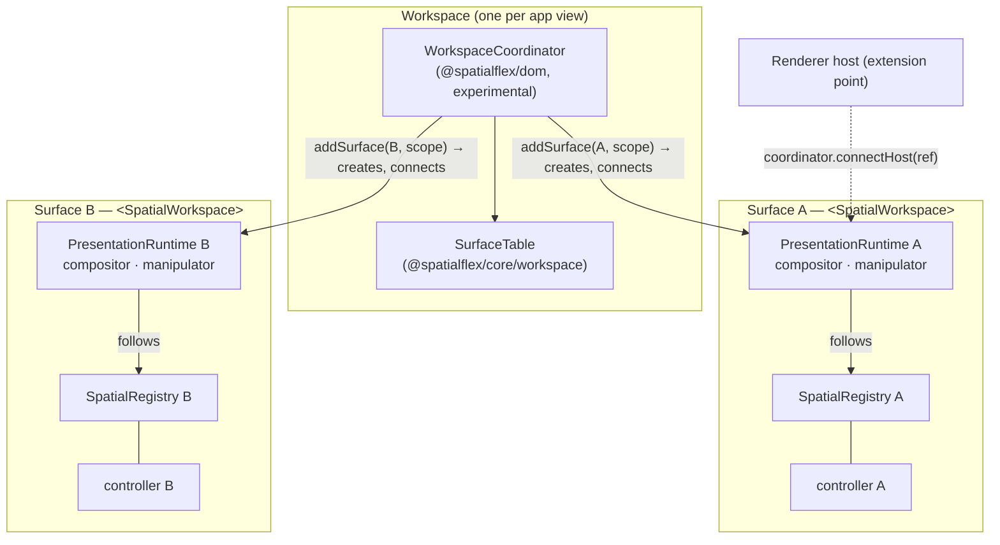

# P1-08B1: Multi-Surface Workspace Runtime (experimental)

**Status:** the first P1-08B stage. Several independent React web Surfaces
can be registered in one Workspace, each keeping its own registry, DOM
controller and `PresentationRuntime` (ADR 0001).

**Not included:** depth resolution, intersecting-Surface clipping, a shared
3D scene and cross-Surface input routing. These are later stages, and
ADR 0003 is still Proposed.

**Baseline:** main `1b50693` (P1-08A2 merged).

## 1. Architecture



### Who owns what

**`WorkspaceCoordinator`** (`packages/dom/src/workspace/coordinator.ts`)
owns only Workspace-level lifecycle:

- **Surface identity and incarnations.** It uses the P1-08A `SurfaceTable`,
  so each Surface has an id and an epoch.
- **Each Surface's runtime.** It creates and connects a Surface's own
  `PresentationRuntime` when the Surface is added, and disconnects it when
  the Surface is removed. Disconnecting ends that Surface's presentations
  and restores the originals.
- **Workspace-level addressing.** `ScopedPresentationRef` combines the
  Surface incarnation, the item registration and the instance id. Instance
  ids are per runtime (`adaptive-1` exists on every Surface), so they cannot
  identify a presentation alone.
- **Stale-reference refusal.** `invoke`, `restore`, `extract`,
  `setGeometry` and `connectHost` act only on the current incarnation and
  the current registration.
- **Renderer-host extension point.** `connectHost(ref, options)` returns
  that Surface's `PresentationHost`.

**Each Surface** (one `<SpatialWorkspace>`) keeps:

- its own registry and controller;
- through the coordinator, its own runtime, compositor and manipulator.

**What is never shared:** no registry or runtime is shared between
Surfaces. `addSurface` rejects a registry that is already used by another
live Surface (`SHARED_SOURCE_SCOPE`).

### Lifecycle rules (all tested)

| Event                                 | Effect                                                                                                                                                                                           |
| ------------------------------------- | ------------------------------------------------------------------------------------------------------------------------------------------------------------------------------------------------ |
| `addSurface(id, scope, { geometry })` | `SurfaceTable.add` runs first, so a rejected id (`DUPLICATE_SURFACE_ID`, `INVALID_SURFACE_ID`) creates no runtime. Then the runtime is created and `connect()`ed.                                |
| `removeSurface(ref)`                  | Removes exactly that incarnation and disconnects its runtime, which ends its presentations and releases its registry listeners. Other Surfaces are untouched. A stale ref is a no-op.            |
| re-add the same id                    | Creates a new epoch and a new runtime. Old `SurfaceRef`s and `ScopedPresentationRef`s are refused, even though the new runtime reuses the same instance ids and the item keeps its registration. |
| item remounted inside a live Surface  | The item gets a new registration key, so old scoped refs are refused (`SurfaceTable.isCurrent`).                                                                                                 |
| `setGeometry(ref, g)`                 | Moves the live incarnation (pose base) without re-registering it. It replaces the frozen record (records are never mutated), and value-equal geometry changes nothing.                           |
| `dispose()`                           | Removes every Surface and clears listeners; any later `addSurface` throws `DISPOSED`.                                                                                                            |

## 2. Public API changes (all additive, all marked EXPERIMENTAL)

Existing APIs and their behavior are unchanged.

| Package                      | Addition                                                                                                                                                                                                                                                                                                                |
| ---------------------------- | ----------------------------------------------------------------------------------------------------------------------------------------------------------------------------------------------------------------------------------------------------------------------------------------------------------------------- |
| `@spatialflex/core`          | New subpath `@spatialflex/core/workspace`: the P1-08A primitives (`SurfaceTable`, `SurfaceRef`, `ScopedItemRef`, `ScopedPresentationRef`, `SurfaceGeometry`, coordinates, `FrameAuthority`, `InputRouter`). The root entry is unchanged. `WorkspaceContractError` gains the codes `SHARED_SOURCE_SCOPE` and `DISPOSED`. |
| `@spatialflex/dom`           | `WorkspaceCoordinator`, `freezeGeometry`, `sameGeometry`, and the types `SurfaceSourceScope`, `AddSurfaceOptions`, `WorkspaceSurface`, `WorkspaceSnapshot`, `ScopedExtractResult`.                                                                                                                                      |
| `@spatialflex/react/spatial` | `useWorkspaceCoordinator()`, `useSpatialSurface(coordinator, id, { geometry, runtime? })`, `useWorkspaceSurfaces(coordinator)`, and re-exports of the coordinator and its types.                                                                                                                                        |

**What stays unchanged:**

- `<SpatialWorkspace>` keeps the same props and behavior. It remains the
  source scope of one Surface.
- `useSpatialPresentations` is unchanged.
- Single-Surface consumers need no change. The external consumer E2E and
  the package smoke test pass.

**Usage rule:** in a Surface registered with `useSpatialSurface`, do **not**
also call `useSpatialPresentations`. Both would create a runtime over the
same registry.

### Immutability contract

Geometry is an immutable value.

- **Inputs are copied.** `addSurface` and `setGeometry` deep-copy the
  geometry and freeze it (`freezeGeometry`). The copy has a fixed, tiny
  shape, so the cost is O(1).
- **Inputs cannot be changed afterwards.** Mutating the caller's object
  later (for example `pose.position[0] = …`) never changes a Surface. A move
  needs a new geometry value.
- **Outputs are deeply frozen and never mutated.** This covers
  `WorkspaceSnapshot`, its `surfaces` array, every `WorkspaceSurface` record
  and its geometry. On a change, records are replaced; old records keep
  their values.
- **Two fields are intentionally live:** `registry` and `runtime` are the
  Surface's own objects (handles), not data.
- **Equal values publish nothing.** `setGeometry` with value-equal geometry
  (`sameGeometry`) returns `true`, creates no new snapshot version, and
  notifies nobody.
- **One source of truth in React.** `useSpatialSurface` keeps only the
  `SurfaceRef` in React state. Its returned `surface` is read from the
  coordinator (`useSyncExternalStore`), so after any move it is identical
  to `coordinator.surface(ref)`, including its geometry.

### React semantics

**`useSpatialSurface`:**

- Registers the Surface in a layout effect, before paint, like
  `useSpatialPresentations`.
- Removes exactly its incarnation in the cleanup.
- A new `geometry` object calls `setGeometry` and does not re-register.
- Under StrictMode, the simulated unmount and remount yield a new epoch.
  Only the last incarnation stays live (tested).

**`useWorkspaceCoordinator`:**

- Owns one coordinator per mount.
- It deliberately does **not** dispose it on unmount. Every Surface's own
  cleanup already removes that Surface and its runtime, and runs before the
  owner unmounts.
- A first implementation that disposed on unmount broke StrictMode: the
  simulated remount re-ran the children's effects against a disposed
  coordinator. The unit test caught it.

## 3. XR Lab fixture

`apps/xr-lab/multi-surface.html` (source:
`apps/xr-lab/src/multisurface/MultiSurfaceLab.tsx`) is its own page. The XR
Lab shell (`LabShell`) and its renderer hosts are unchanged.

**What it contains:**

- Two Surfaces, A and B. Each is a `<SpatialWorkspace>` with a real
  `SpatialRegistry`, and a `PresentationRuntime` created through
  `useSpatialSurface`.
- Both register an item with the same id, `chart`. It contains a counter, a
  text input and an XR view with a parent-owned `increment` action.
- Real UI controls:
  - present the item as an Adaptive panel (`coordinator.extract`);
  - run its action through the scoped reference (`coordinator.invoke`);
  - restore it;
  - move the Surface's pose (`setGeometry`);
  - remove and re-add Surface A;
  - replay the last saved A reference after A is removed or re-added.
- A read-only probe (`window.__multiSurfaceLab`, in test-hook builds only).

**How to run it:**

```bash
cd apps/xr-lab && pnpm dev   # then open /multi-surface.html
```

## 4. Verification

### Unit tests (jsdom; real `SpatialRegistry`, `PresentationRuntime`, React 19 + StrictMode)

`packages/dom/src/workspace/coordinator.test.ts` (11 tests):

1. Two Surfaces registered, each with its own runtime and its own registry
   listeners.
2. The same item id on two Surfaces: the instance ids are equal, the scoped
   refs are distinct, and an action reaches only its own Surface.
3. Removing A ends A's presentations and releases A's listeners (0). B's
   presentation, listeners and actions remain.
4. Re-adding A gives a new epoch. The old ref is refused for `invoke`,
   `restore`, `extract`, `setGeometry` and `connectHost`, even when the new
   runtime presents the same `adaptive-1` for an unchanged registration.
5. A remounted item makes its scoped refs stale.
6. Duplicate id, shared registry and invalid id are rejected without
   creating a runtime.
7. 50 add/remove cycles: registry listeners return to 0 each time, epochs
   increase, there are exactly 100 change notifications, and B stays intact.
8. `setGeometry` and `connectHost` act on the live incarnation (a host frame
   produces rays).
9. `dispose` removes everything, then any further use throws.
10. Geometry is copied and deeply frozen on input. Mutating the caller's
    object afterwards changes nothing, frozen outputs throw on write, and
    the snapshot and records are frozen while `runtime` stays live.
11. `setGeometry` replaces the record and leaves the old record untouched.
    Equal values publish nothing.

`packages/react/src/workspaceSurface.test.tsx` (9 tests):

1. Two `<SpatialWorkspace>` Surfaces register with their own registries and
   runtimes. After StrictMode, only the final incarnations are live.
2. State and scoped actions are isolated per Surface.
3. Removing A leaves B with the same DOM node, the same state, no remount
   and a live presentation. Re-adding A gives a new epoch and a fresh
   subtree, and A's old ref is refused.
4. A new geometry moves the Surface without re-registering it. The stored
   geometry is a frozen copy, equal by value.
5. Unmounting removes every Surface and ends every runtime.
6. Server rendering registers nothing.
7. After a geometry change, the hook's `surface` (and its geometry) is
   identical to `coordinator.surface(ref)`. This was a bug found in the
   pre-merge review: the hook used to return the stale record.
8. Mutating a passed geometry in place and re-rendering with the same
   object changes nothing: same stored geometry, same snapshot version.
9. After removal, the coordinator has no record, and the other Surface
   remains.

### Browser E2E (`apps/xr-lab/e2e/multi-surface.spec.ts`; Chromium and Firefox; real input)

1. Two Surfaces with distinct epochs and distinct registrations of the same
   item id.
2. Counters, typed inputs and XR actions stay within their Surface. Both
   Surfaces show `adaptive-1`.
3. Removing A keeps B (same node, state, input value and presentation).
   Replaying A's saved ref is refused. Re-adding A gives a new epoch, a
   fresh state, and new actions are accepted.
4. Moving A's pose changes only A's geometry and keeps its epoch.
5. Ten remove/re-add cycles: exactly two Surfaces, increasing epochs, no
   stale presentations, and the only live presentation is B's.

### Regression

The full suites were run (§7 of the PR). This includes the existing Three.js
and Babylon.js XR Lab paths, the playground, the external consumer and the
package smoke test.

## 5. Not implemented (deliberately)

> **Update (P1-08B3):** the shared scene, depth clipping, `FrameAuthority`
> frames and `InputRouter` routing are implemented in
> [`p1-08b3-multisurface-xr-integration.md`](p1-08b3-multisurface-xr-integration.md),
> with Adaptive presentations only. The list below describes B1 as merged.

- **Depth resolution and intersecting-Surface clipping.** These belong to
  ADR 0003 and the Agent B depth resolver.
- **A shared 3D scene.** Both Surfaces are ordinary page DOM in this
  fixture; neither is placed by `surfaceTransform` into one renderer view.
- **Cross-Surface input routing** (`InputRouter`) and **frame authority**
  (`FrameAuthority`) across hosts.
- **Native presentations in the fixture.** The coordinator supports them,
  because it is the same runtime, but the fixture exercises Adaptive only.
- **A renderer host driving several Surfaces.** `connectHost(ref)` exists
  and is unit-tested, but no Three.js or Babylon host uses it yet.

## 6. Integration points with the depth resolver (Agent B)

- **Inputs** the resolver needs come from `coordinator.getSnapshot()`:
  - `surfaces[i].geometry` (`SurfaceGeometry`, the P1-08A contract);
  - `surfaces[i].ref` (`SurfaceRef`);
  - for Native and Adaptive presentations, `coordinator.presentations()`
    (scoped refs) and each runtime's poses.
- **Outputs:**
  - per-Surface clip regions go to each runtime's frame call
    (`HostFrameOptions.occluders`, or a future keep/clip option);
  - the per-ray owner goes to `InputRouter` (with `ScopedPresentationRef`
    owners).
- **Exports:** `depthResolver` is not exported or imported anywhere in this
  stage. When it lands, it can be added to `@spatialflex/core/workspace` in
  one line (`packages/core/src/workspace/index.ts`, owned by Agent A).

## 7. Conditions for the next stage

1. ADR 0003 accepted, and the depth resolver merged with its tests.
2. A renderer host (Three.js first) consumes `coordinator.connectHost(ref)`
   for each Surface under one `FrameAuthority`.
3. Surfaces are placed by `surfaceTransform` in one view, with clips from
   the resolver.
4. `InputRouter` captures, keyed by scoped refs; removing a Surface cancels
   gestures in flight.
5. Re-measure clip writes and compose cost for N > 2 Surfaces (P1-07C and
   P1-08A2 cost centre).
