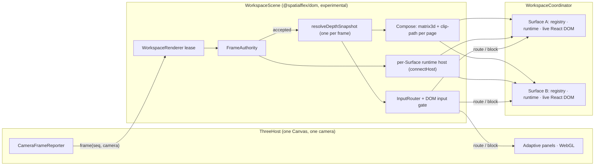

# P1-08B3 — Multi-Surface XR Scene Integration

- **Status:** experimental MVP (draft PR, not merged)
- **Base:** `main` at `faf9f28`, which includes PR #45 (P1-08B1 Workspace
  runtime) and PR #44 (depth resolver)
- **Fixture:** `apps/xr-lab/multi-surface-xr.html`
- **Builds on:**
  - [P1-08B1 runtime](p1-08b1-multisurface-runtime.md)
  - [depth resolver](p1-08b-depth-resolver.md)
  - ADR [0001](adr/0001-multi-surface-runtime-ownership.md),
    [0002](adr/0002-multi-surface-composition-and-occlusion.md) and
    [0003](adr/0003-unified-depth-ownership.md) (still **Proposed**)

Independent React Surfaces (2, 3 or 5) share one Three.js scene with one
camera and one render loop. The parts are connected as follows:

- **Frames:** the existing `FrameAuthority` controls the camera frame of
  every Surface.
- **Screen and input:** one immutable `resolveDepthSnapshot` per frame
  clips the pages and answers the pointer ray.
- **Pointer routing:** the existing `InputRouter` owns real pointer
  gestures.
- **State:** each Surface keeps its own registry, `PresentationRuntime` and
  React state. Moving, removing or re-adding one Surface never remounts
  another.

**What this is not:**

- The Surface pages are **live DOM composited over the WebGL canvas**
  (`surfaceTransform`, CSS `matrix3d`, `clip-path`). They are not WebGL
  textures.
- Adaptive panels are drawn by Three.js.
- Inside an immersive WebXR session the DOM pages cannot be shown. See §6
  for what was verified where.

## 1. Pre-implementation review of the contracts

These are the findings from reading the code before implementing. They
determined the design.

| Contract                              | Finding                                                                                                                                                                                                                     | Consequence                                                                                                                                                                   |
| ------------------------------------- | --------------------------------------------------------------------------------------------------------------------------------------------------------------------------------------------------------------------------- | ----------------------------------------------------------------------------------------------------------------------------------------------------------------------------- |
| `FrameAuthority`                      | One authoritative lease at a time; first submitter wins by default; `authorize` discards the old frame; per-lease sequences (equal or older = stale); disconnect clears the authority.                                      | Used as is. It is the only gate of the frame path.                                                                                                                            |
| `PresentationRuntime.connectHost`     | Each runtime has its own "first host to frame wins" rule. A host that stays connected after a workspace-level handover would remain that runtime's frame source.                                                            | Runtime hosts are connected **only for the authoritative lease**. On a handover the new hosts connect first, then the old ones disconnect, so no runtime ever sees "no host". |
| `resolveDepthSnapshot`                | Atomic, copies its input, freezes its output, throws `IndeterminateDepthError`. Rays start at the snapshot's eye. Front faces only. `keep` regions are not supported. It was not exported.                                  | Exported (snapshot API only). Every pointer ray is taken from the camera eye of the same frame. Native DOM is out of scope in the shared scene (see §7).                      |
| `InputRouter`                         | Decides ownership, never delivers events. A non-interactive front hit yields no owner. Gestures end on owner death or authority loss.                                                                                       | A capture-phase DOM gate enforces its decisions on real events (§3.4).                                                                                                        |
| ADR 0003 (Proposed) vs. SDK resolver  | The SDK resolver differs from the research version: it ignores back faces, breaks exact coplanar ties by key, and fails closed. Its research reproductions remain as expected failures in `depthResolver.research.test.ts`. | B3 follows the SDK resolver. Review in §8. ADR 0003 stays Proposed.                                                                                                           |
| ADR 0002 rule 4 (no interpenetration) | Rule 4 left interpenetration open, with "clip splitting along the intersection line" as a candidate.                                                                                                                        | B3 implements that candidate for planar pages and Adaptive panels. The rule is lifted only when ADR 0003 is accepted.                                                         |

## 2. Architecture

### 2.1 One frame

1. **Submit.** `ThreeHost` reports the final camera of each rendered frame
   as before (`onCameraFrame`). The fixture calls
   `renderer.frame(++sequence, frame)`, and the frame is copied.
2. **Authority check.** `FrameAuthority.submit` decides. Only `accepted`
   frames continue. Stale frames, frames of a non-authoritative renderer
   and frames of a disconnected renderer change nothing.
3. **Runtime hosts.** Every live Surface gets a runtime host for the
   current authority lease (§2.2).
4. **Depth snapshot.** One `resolveDepthSnapshot` runs over these planes,
   all from the coordinator's current, frozen geometries:
   - `surface:<id>@<epoch>`: every live page;
   - `panel:<id>@<epoch>/<instance>`: every Adaptive panel, at its
     manipulator pose.
5. **Compose.** Each attached page gets:
   - `surfaceTransform` (its `matrix3d`);
   - its own snapshot `clipPath` (`none` when nothing hides it);
   - visibility (hidden when back-facing, behind the near plane or fully
     hidden);
   - `z-index` far to near, which only breaks ties;
   - `data-depth=<status>`.

   Styles are written only when they change.

6. **Forward to runtimes.** Every Surface's runtime receives the same
   frame through its own `PresentationHost.frame`.

### 2.2 Lifecycle

| Event                                          | Effect                                                                                                                                                                               |
| ---------------------------------------------- | ------------------------------------------------------------------------------------------------------------------------------------------------------------------------------------ |
| Surface added (`useSpatialSurface`)            | Its page attaches hidden. It gets a runtime host and a clip on the next accepted frame.                                                                                              |
| Surface moved or rotated (`setGeometry`)       | The coordinator publishes a new frozen record. The scene drops its snapshot, so input waits for the next frame. Same epoch, no remount.                                              |
| Surface removed                                | Its gestures are cancelled (`InputRouter.surfaceRemoved`), its runtime host disconnects, and its page is detached. No later frame reaches it.                                        |
| Surface re-added                               | New epoch. Every key, plane, route and panel id carries the epoch, so nothing of the old incarnation matches.                                                                        |
| Renderer handover (`authorize`)                | The old camera, snapshot and gestures are discarded. Status becomes `waiting` and pages are hidden until the new authority's first frame. Runtime hosts are swapped, new before old. |
| Renderer disconnect (e.g. `ThreeHost` remount) | Authority revoked, gestures cancelled, its runtime hosts disconnected (with the P1-07B3 rule: the last host ends the presentations it drew), status `waiting`.                       |
| Immersive session (`onSessionChange`)          | Status `suspended`: pages hidden, all page input refused, gestures cancelled. Frames are still accepted for the runtimes. Exiting resumes on the next frame.                         |

### 2.3 Fail-closed depth policy

`IndeterminateDepthError` can come from building the snapshot or from a
later ray query on it. In both cases:

- **Snapshot.** Nothing of the failed snapshot is published or applied. The
  previous snapshot is dropped (`scene.depth === null`) and is never reused
  for input.
- **Input.** Every gesture is cancelled, keyboard focus is released (the
  router's focus is cleared and the focused page element is blurred), and
  all page input is refused while the status is `indeterminate`.
- **Screen.** The default display is `fallback`: each page stays at the
  current frame's transform, unclipped, in far-to-near order, and is marked
  `data-depth="indeterminate"`. The fixture greys it out with a red
  outline. It is explicitly **non-interactive**.

  `indeterminateDisplay: "hidden"` hides the pages instead. Surfaces do
  **not** disappear by default: the policy prevents a wrong screen/input
  pairing; it does not punish unstable geometry.

- **Camera.** The canvas keeps camera navigation (no route, so panel
  actions are refused), so the user can move out of a degenerate view.
- **Recovery.** The next frame that resolves returns to `resolved`.
- **Diagnostics.** `getSnapshot().error` reports `{sequence, phase:
"snapshot" | "ray", name, message}`, and `counters.failures` counts the
  failures.

Unexpected errors from the resolver are also handled fail-closed (same
path) and reported with their own name.

## 3. Runtime and API changes (all additive, all EXPERIMENTAL)

### 3.1 `@spatialflex/core/workspace`

This entry exports only the snapshot API of the resolver:

- `resolveDepthSnapshot`;
- `IndeterminateDepthError`;
- the types `DepthPlane`, `DepthHit`, `VisibilityResult`, `DepthPoint` and
  `DepthPolygon`.

The low-level helpers (`resolveVisibility`, `depthOwner`, `hiddenRegion`,
…) stay internal. They lack the snapshot's whole-or-nothing error contract
and its input copying. `depthResolver.ts` itself is unchanged, and the root
`@spatialflex/core` entry is unchanged.

### 3.2 `@spatialflex/dom`: `WorkspaceScene`

| API                                                                                                    | Purpose                                                                                                                                                     |
| ------------------------------------------------------------------------------------------------------ | ----------------------------------------------------------------------------------------------------------------------------------------------------------- |
| `new WorkspaceScene(coordinator, { indeterminateDisplay?, resolve?, now? })`                           | One per coordinator. It subscribes lazily on first use, so an instance React discards never subscribes. `resolve` and `now` are injection points for tests. |
| `connectRenderer(hostId) → { lease, frame(seq, camera), authorize(), setImmersive(on), disconnect() }` | The frame path (§2.1). Each call returns a `FrameVerdict`.                                                                                                  |
| `attachLayer(el)` / `attachPage(ref, el)`                                                              | The fixed layer over the canvas and each Surface's live page. Each returns a detach function.                                                               |
| `setInteractive(ref, on)`                                                                              | A non-interactive Surface still occludes: input under it goes to nobody.                                                                                    |
| `bindInput(root, isScene)`                                                                             | Installs the DOM input gate (§3.4).                                                                                                                         |
| `pointerDown` / `pointerContinue` / `activation` / `keyboard` / `focusIn` / `adaptiveAction(ref)`      | The DOM-free decisions behind the gate. They are unit-tested directly.                                                                                      |
| `getSnapshot()` / `subscribe()`                                                                        | `{status, authority, error}`. Changes on status changes only, never per frame.                                                                              |
| `depth`, `inspect()`, `counters`, `timings`                                                            | Diagnostics: current snapshot, per-Surface view, hosts, pages, gestures, mismatches, and the last 600 timings of each kind.                                 |
| `poseOfGeometry(g)`, `surfaceKey(ref)`                                                                 | `SurfaceGeometry` (quaternion) to the DOM compositor's pose (XYZ Euler). A unit test checks it against `cssToWorld`.                                        |

### 3.3 XR Lab host contract

`XRHostProps.onSessionChange?(mode)` is a new optional callback. It is
called by `ThreeHost`. Existing hosts and callers are unaffected.

### 3.4 The DOM input gate

The gate listens in the capture phase on a root that contains the pages
and the canvas.

| Event                                                                 | Rule                                                                                                                                                                                                                                                                                                                                                                                                                      |
| --------------------------------------------------------------------- | ------------------------------------------------------------------------------------------------------------------------------------------------------------------------------------------------------------------------------------------------------------------------------------------------------------------------------------------------------------------------------------------------------------------------- |
| `pointerdown`                                                         | The ray of the same frame through the client point goes to `snapshot.depthOwner`, then to `InputRouter.down`. The DOM target must be that owner: the owner's page for a Surface, the canvas for an Adaptive panel. Otherwise the event is cancelled (`mismatches`). A non-interactive front Surface makes the router return no owner, so the event is cancelled. On success, the target element gets `setPointerCapture`. |
| `pointermove` / `pointerup` / `pointercancel`                         | Only the gesture's owner. `InputRouter.move/up` rejects gestures whose owner died or whose host lost authority. A hover move without a gesture reaches a page only where that page owns the ray.                                                                                                                                                                                                                          |
| `click`, `dblclick`, `auxclick`, `contextmenu`                        | Only on the page that owned the gesture that just ended.                                                                                                                                                                                                                                                                                                                                                                  |
| `mousedown` / `mouseup`                                               | Cancelled while a blocked gesture is down (no focus or selection side effects).                                                                                                                                                                                                                                                                                                                                           |
| `keydown`, `keyup`, `keypress`, `beforeinput`, `paste`, `cut`, `drop` | Only to the router's keyboard owner (set by a routed pointer down or an accepted `focusin`), and only while `resolved`.                                                                                                                                                                                                                                                                                                   |
| `focusin`                                                             | Refused (the element is blurred) unless the scene is `resolved` and the Surface is live and interactive.                                                                                                                                                                                                                                                                                                                  |

**Native DOM events and Adaptive actions use different paths:**

- **Native DOM events:** the browser delivers them to the page element; the
  gate only lets them through or cancels them.
- **Adaptive actions (desktop):** Three.js raycasts and `Panel3D` reports
  the action. The fixture then calls `scene.adaptiveAction(ref)`, which
  accepts only the presentation that owned the routed gesture that just
  ended (consumed once), and finally `coordinator.invoke(ref)`.
- **Adaptive actions (immersive XR controller):** this path is **not**
  routed through `InputRouter` in this stage. The scene is `suspended`, and
  the fixture refuses panel actions there.

## 4. XR Lab fixture (`multi-surface-xr.html`)

- **Surfaces.** Each Surface is a `<SpatialWorkspace>` with
  `useSpatialSurface`. Its page (400 × 300 CSS px, 2.5 mm/px) has:
  - a counter and an input inside the same item id `chart`, with an XR
    view and action `increment`;
  - Present and Restore buttons (Adaptive);
  - a hit counter (`pointerdown` on the page);
  - a pointer pad that logs the gesture events it receives.
- **Controls.** These sit outside the scene:
  - layouts `side`, `cross` (an X crossing) and `ambiguous` (A 1e-14 m in
    front of B's plane);
  - Move A and Rotate A;
  - Remove/Add A;
  - Restart renderer;
  - "B interactive".

  While a mouse button is held, Alt+Shift+1 toggles A and Alt+Shift+2
  restarts the renderer.

- **Surface count.** `?surfaces=3|5` adds Surfaces C–E behind A and B.
- **Probe.** `window.__multiSurfaceXR` exists in test-hook builds only. It
  is read-only (`resetMetrics` empties measurement buffers only).
  `point(id, u, v)` projects a page point through the **Three.js camera**
  (`__xrHostProbe.project`), independently of the scene's own math.
- **StrictMode.** The page runs in `StrictMode`.
- **B1 fixture.** `multi-surface.html` and its tests are unchanged.

## 5. Verification

### 5.1 Unit and integration (`packages/dom/src/workspace/scene.test.ts`, 21 tests)

These run in jsdom over a real `WorkspaceCoordinator`, `SpatialRegistry`,
`PresentationRuntime` and the real resolver.

- **Geometry and frames:**
  - DOM pose = core `cssToWorld` (rotated pose, 4 points, 1e-12);
  - only the authoritative, newest frame composites (stale `1, 0` rejected);
  - handover drops the old camera (`waiting`, pages hidden, input refused,
    old renderer `not-authoritative`);
  - disconnect revokes authority and a new lease takes over;
  - one runtime host per live Surface for the authority, swapped on
    handover, disconnected on removal; a removed Surface gets no frame.
- **One snapshot for screen and input:**
  - an independent ray–plane check that the probe points are where A and B
    are in front;
  - page clips equal the snapshot's `clipPath`, and the routed owner matches
    on both sides;
  - a DOM target that is not the depth owner is refused (`mismatches`);
  - a non-interactive front Surface blocks every target, including the
    canvas, while B stays usable where it is in front;
  - move and up keep the owner; activation only on the owner;
  - removal cancels the gesture, and the re-added epoch never gets it;
  - authority loss cancels the gesture;
  - Adaptive panels with equal item and instance ids on A and B are routed
    to their own presentation; the page target behind a panel is refused;
    actions are consumed once.
- **Fail-closed:**
  - an injected snapshot error leaves no snapshot and no gestures, refuses
    input and shows the marked, unclipped fallback, then recovers;
  - the real resolver fails closed on a near-coplanar pair;
  - a ray-query error invalidates the whole snapshot;
  - the `hidden` display policy hides the pages;
  - an immersive session suspends and later resumes.
- **DOM gate and lifecycle:**
  - unrouted clicks and keys are cancelled, routed ones are delivered, and
    unbinding restores normal events;
  - 50 remove/add cycles leave 2 hosts, 2 pages, 0 gestures and 0 extra
    registry listeners;
  - an unused scene never subscribes.

### 5.2 Browser E2E (`apps/xr-lab/e2e/multi-surface-xr.spec.ts`)

There are 13 tests per browser, run in Chromium and Firefox. Input is real
`page.mouse` / `page.keyboard`.

| Test                | What it checks                                                                                                                                                                                                                       |
| ------------------- | ------------------------------------------------------------------------------------------------------------------------------------------------------------------------------------------------------------------------------------ |
| Shared scene        | 2 Surfaces with different epochs, one renderer lease, one `<canvas>`, 2 runtime hosts, pages `matrix3d`.                                                                                                                             |
| Scenario 1          | Counters and inputs isolated. Both Surfaces present `chart` as `adaptive-1`. A real click on A's **WebGL** panel button (`elementFromPoint` = canvas) increments A only.                                                             |
| Scenario 2          | Move and rotate A: same epoch, A's transform changes. B's record, transform, DOM node, count and input value are unchanged.                                                                                                          |
| Scenario 3 (owners) | X crossing: each page's `hiddenBy` is the other Surface. At 4 points (2 per side), the **painted** owner (screenshot pixels), **`elementFromPoint`** and the **page a real click reaches** all agree: A on the left, B on the right. |
| Scenario 3 (change) | Moving A 0.3 m changes A's clip, and the same client point changes owner B → A on screen, in hit-testing and on click. 0 mismatches.                                                                                                 |
| Non-interactive     | B non-interactive and in front: the browser would deliver to B, but neither B nor A behind it gets the click. A still works.                                                                                                         |
| Gesture capture     | Down on A's pad, move over B, release on B: A gets `down,move,up`, B gets nothing.                                                                                                                                                   |
| Scenario 4          | Mouse held on A's counter. Remove A, then re-add A (new epoch). Release on the new A: no click. B keeps its node, state and presentation. Hosts and pages = 2.                                                                       |
| Renderer restart    | Mouse held, renderer restarted (new lease), release: no click. Then normal.                                                                                                                                                          |
| Scenario 5          | `ambiguous` → `indeterminate` ("Nearly coplanar planes are numerically ambiguous"). Both pages are visible, unclipped and marked. Clicks, focus and typing are all refused. `side` → `resolved` and working.                         |
| Repeated lifecycle  | 10 remove/re-add cycles, increasing epochs, then 2 hosts, 2 pages, 0 gestures.                                                                                                                                                       |
| Five Surfaces       | 5 resolved pages and 5 hosts. Cross-layout clicks on A and B are routed. 0 mismatches.                                                                                                                                               |
| IWER immersive      | Enter VR (emulated): `suspended`, frames keep advancing, pages hidden and in `waiting` state, the Adaptive presentation is still live. Exit VR: `resolved`, then clicks work.                                                        |

**Mutation checks** were run locally and then reverted:

- **Input gate removed:** 6 of 13 Chromium tests fail (the panel action
  gate, the non-interactive case, capture, Scenario 4, the renderer
  restart and Scenario 5).
- **Clips disabled:** both Scenario 3 tests fail. The painted and
  `elementFromPoint` owners become wrong (A over B on the right), and the
  click reaches **no** page: the gate refused the inconsistent target.

### 5.3 Regression

Each check below was run on this branch:

- **Full XR Lab E2E, Chromium and Firefox:** 413 passed, 9 skipped, 0
  failed.
  - It covers every existing spec: single Surface, Native DOM, Babylon.js
    (including pointer and immersive IWER), the B1 `multi-surface.spec.ts`,
    the P1-08A2 research and the new suite.
  - The 9 skips are the existing HTML-in-Canvas tests in Firefox.
- **Unit tests:** `pnpm test`: core 215 (+ 2 pre-existing expected-failure
  research reproductions), dom 96, react 100, playground 14, xr-lab 105.
- **Static checks:** `pnpm lint`, `format:check`, `typecheck` and `build`
  all pass.
- **Packaging:** `pnpm smoke:pack` passes (external npm consumer, packaged
  build).
- **Evidence files:** historical files rewritten by these runs were
  restored and are not committed.

## 6. Where each capability was verified

| Capability                                                         | Browser (Chromium, Firefox; desktop, headless; software WebGL) | IWER emulator (Chromium, Firefox) | Real HMD          |
| ------------------------------------------------------------------ | -------------------------------------------------------------- | --------------------------------- | ----------------- |
| Live DOM pages composited in one Three.js scene                    | ✔ verified                                                     | n/a (DOM not shown in XR)         | not verified      |
| X-crossing visibility = depth owner = input owner                  | ✔ verified                                                     | n/a                               | not verified      |
| `FrameAuthority` frame path, handover/restart, stale frames        | ✔ (unit for handover and stale frames; E2E for restart)        | not exercised                     | not verified      |
| `InputRouter` with real pointer and keyboard                       | ✔ mouse and keyboard (touch and pen not tested)                | not routed (XR controller)        | not verified      |
| Fail-closed depth                                                  | ✔ verified                                                     | —                                 | —                 |
| Adaptive panels (WebGL) rendered and frames advancing in a session | desktop ✔                                                      | ✔ session created, frames advance | **not verified**  |
| DOM pages inside an immersive session                              | —                                                              | suspended (by design)             | **not supported** |

IWER results are emulator results. They are not evidence of HMD behaviour.

## 7. Not supported and not done (deliberately)

- **Native DOM presentations in the shared scene.** The snapshot has no
  `keep` footprints. A page clipped by depth would clip its own extracted
  Native descendants, and their protrusion is not a depth plane. Emulating
  this would be ad-hoc geometry, so it is **not done**. The B1 fixture and
  the single-Surface lab keep Native DOM. This is a prerequisite for the
  next stage.
- **Non-planar content, curved Surfaces, panel buttons as separate
  planes.** A panel is modelled by its face rectangle. Its buttons sit 5 mm
  in front of it.
- **Immersive WebXR:**
  - the DOM pages are not presentable in the XR view;
  - XR controller input to panels is not routed through `InputRouter`;
  - real-HMD rendering is unverified.
- **Babylon.js in the shared scene.** Only Three.js drives
  `WorkspaceScene`. Babylon's single-Surface lab is unchanged (regression
  in §5.3). ADR 0003 notes that Babylon's `HtmlInteractionManager` is not
  depth-correct.
- **HTML-in-Canvas.** Not used.
- **Keyboard focus is not occlusion-aware** (ADR 0003 open item). Tab can
  focus a control in a hidden region of a live page. The gate only keeps
  keys with the focused, live, interactive Surface.
- **Not gated:** `wheel` (the pages do not scroll), touch and pen.
- **The floor and grid are not depth participants.** The pages are drawn
  over the WebGL floor. All fixture pages are above it.
- **The sub-pixel seam** on the intersection line is not measured.
  Boundary points are excluded from the E2E checks.

## 8. ADR 0003 review (status unchanged: **Proposed**)

| ADR 0003 item                                                 | Research (P1-08A2)                           | SDK and B3 implementation                                                                                                 | Verdict                |
| ------------------------------------------------------------- | -------------------------------------------- | ------------------------------------------------------------------------------------------------------------------------- | ---------------------- |
| 1. Geometry decides ownership; the resolver also answers rays | research resolver                            | `resolveDepthSnapshot`: one snapshot per frame for both, with the same planes and eye.                                    | **Adopt**              |
| 2. DOM compositor applies `path(nonzero)` clips per page      | demonstrated                                 | implemented; z-index is a tie-breaker only                                                                                | **Adopt**              |
| 2. Page keeps its Native descendants' footprints              | demonstrated in research                     | **not supported** by the snapshot (`keep`)                                                                                | **Open**: next stage   |
| 2. HTML-in-Canvas variant                                     | Chromium only, hit order by registration     | not implemented                                                                                                           | Open                   |
| 3. Per-region occluder tests (not centroid)                   | proposed                                     | Adaptive panels are depth planes, clipped per region                                                                      | **Adopt** for panels   |
| 4. Disjoint same-orientation loops                            | proposed                                     | resolver `pathClip` (nonzero)                                                                                             | **Adopt**              |
| 5. Planar rectangles only                                     | yes                                          | yes                                                                                                                       | **Adopt**              |
| Back faces and coplanar ties                                  | research: back faces occlude; ties hide both | SDK: back faces excluded; exact ties resolved by key                                                                      | SDK behaviour adopted  |
| Numerical robustness                                          | not addressed                                | `IndeterminateDepthError` plus the B3 fail-closed policy (§2.3)                                                           | **Adopt** (new policy) |
| Input enforcement                                             | "clip makes hit = paint"                     | clip **plus** the router gate (the DOM target must equal the owner); without clips, the gate still refuses the wrong page | **Adopt** (new policy) |
| Seam (≥ 0.5 px overlap policy)                                | open                                         | not measured                                                                                                              | Open                   |
| Keyboard focus occlusion                                      | open                                         | partially gated, Tab not occlusion-aware                                                                                  | Open                   |
| Babylon path                                                  | needs its own hit regions                    | not integrated                                                                                                            | Open                   |

**Recommendation:** accept items 1–5, excluding Native `keep` and
HTML-in-Canvas, together with the two new policies (fail-closed and the
input gate). Do this only after review and real-HMD or hardware-GPU
measurements. Until then the ADR stays **Proposed**, and ADR 0002 rule 4 is
formally still in force.

## 9. Measurements

This was measured for this implementation; it does not reuse the PR #44
exploratory numbers. Raw data: `docs/evidence/p1-08b3/bench-{chromium,firefox}.json`.

**Setup.**

- **Runner:** `apps/xr-lab/bench/multi-surface-xr.bench.ts`, run with
  `playwright.bench.config.ts`. It is opt-in and never part of CI.
- **Build:** a cross-origin-isolated preview (fine timers) of the
  production build.
- **Machine:** Intel i5-9400F, Windows 11, headless browsers with
  **software WebGL**.
- **Per run:** the camera orbits for 240 frames, so every transform and
  clip changes every frame. Then 20 real clicks are made on Surface A.
- **Cells:** median / p95 in ms.

**Columns.**

- _Depth_: `resolveDepthSnapshot`.
- _Compose_: transforms, clips and DOM style writes of all pages.
- _Scene_: the whole accepted frame (depth, compose and runtime hosts).
- _Pointer_: the pointer-down ownership decision (ray, snapshot and
  router).
- _Interval_: the renderer's frame interval, which includes the browser's
  own paint.

| Browser  | Surfaces | Layout | Depth       | Compose     | Scene       | Pointer     | Interval    | Clip vertices |
| -------- | -------: | ------ | ----------- | ----------- | ----------- | ----------- | ----------- | ------------- |
| Chromium |        2 | side   | 0.085/0.215 | 0.100/0.220 | 0.215/0.490 | 0.110/0.580 | 17.69/20.95 | 0+0           |
| Chromium |        2 | cross  | 0.145/0.290 | 0.115/0.240 | 0.290/0.540 | 0.095/0.305 | 22.49/34.86 | 8+12          |
| Chromium |        3 | side   | 0.205/0.395 | 0.115/0.195 | 0.345/0.600 | 0.090/0.240 | 18.01/22.27 | 0+0+16        |
| Chromium |        3 | cross  | 0.195/0.345 | 0.140/0.250 | 0.375/0.590 | 0.105/0.230 | 23.91/39.65 | 8+12+4        |
| Chromium |        5 | side   | 0.375/0.655 | 0.175/0.290 | 0.590/0.940 | 0.080/0.270 | 20.42/23.75 | 0+0+16+8+12   |
| Chromium |        5 | cross  | 0.300/0.550 | 0.140/0.275 | 0.465/0.870 | 0.090/0.250 | 24.28/38.38 | 8+12+4+12+4   |
| Firefox  |        2 | side   | 0.080/0.240 | 0.140/0.300 | 0.280/0.540 | 0.100/0.200 | 8.54/9.98   | 0+0           |
| Firefox  |        2 | cross  | 0.140/0.320 | 0.140/0.320 | 0.320/0.700 | 0.080/0.200 | 8.44/11.50  | 8+12          |
| Firefox  |        3 | side   | 0.160/0.380 | 0.140/0.400 | 0.340/0.860 | 0.080/0.220 | 8.44/9.76   | 0+0+16        |
| Firefox  |        3 | cross  | 0.200/0.600 | 0.200/0.480 | 0.460/1.160 | 0.120/0.440 | 8.64/14.70  | 8+12+4        |
| Firefox  |        5 | side   | 0.340/0.780 | 0.240/0.480 | 0.660/1.260 | 0.100/0.280 | 8.74/14.18  | 0+0+16+8+12   |
| Firefox  |        5 | cross  | 0.520/1.140 | 0.340/0.640 | 1.000/1.780 | 0.100/0.220 | 13.06/16.04 | 8+12+4+12+4   |

**Lifecycle (both browsers).** After 20 remove/re-add cycles of A (with an
Adaptive presentation before the first removal):

- 2 live Surfaces, 2 runtime hosts, 2 attached pages and 2 pages in the
  document;
- 0 active gestures;
- 0 presentations left (A's ended with its incarnation);
- every measured run: 0 mismatches and 0 blocked pointer downs.

The unit test additionally counts registry listeners: 0 after removal, 2
after re-adding.

**Reading.**

- **Scene cost.** The scene's own cost grows with the Surface count, but it
  stays at or below 1.8 ms p95 at 5 Surfaces in both browsers.
- **Chromium frame interval.** The interval rises when clips cut
  (side → cross, about +5 ms median). That is browser compositing of
  `clip-path` on 3D-transformed layers under software WebGL, the P1-07C
  cost centre. It is not the scene's JavaScript.
- **Firefox frame interval.** Headless Firefox is not vsync-bound, hence
  ~8.5 ms.
- **Caveats.** These are single-machine, headless, software-rendering
  numbers. They are not a performance claim or a threshold. Hardware-GPU
  and HMD measurements are still needed.

## 10. Next steps

1. **Native DOM in the shared scene.** Add `keep` footprints to the
   snapshot contract (resolver work with independent tests), then let pages
   keep their extracted descendants.
2. **XR controller routing.** Route the immersive select ray through
   `InputRouter` (`FrameAuthority` lease of the XR session), and decide
   what replaces DOM pages in XR: an explicit non-interactive snapshot
   texture (ADR 0002 "O3") or HTML-in-Canvas where available.
3. **Measurements.** Hardware-GPU and real-HMD measurements. Seam policy
   and keyboard focus occlusion.
4. **ADR 0003.** Accept with the §8 scope, then promote the experimental
   APIs.
