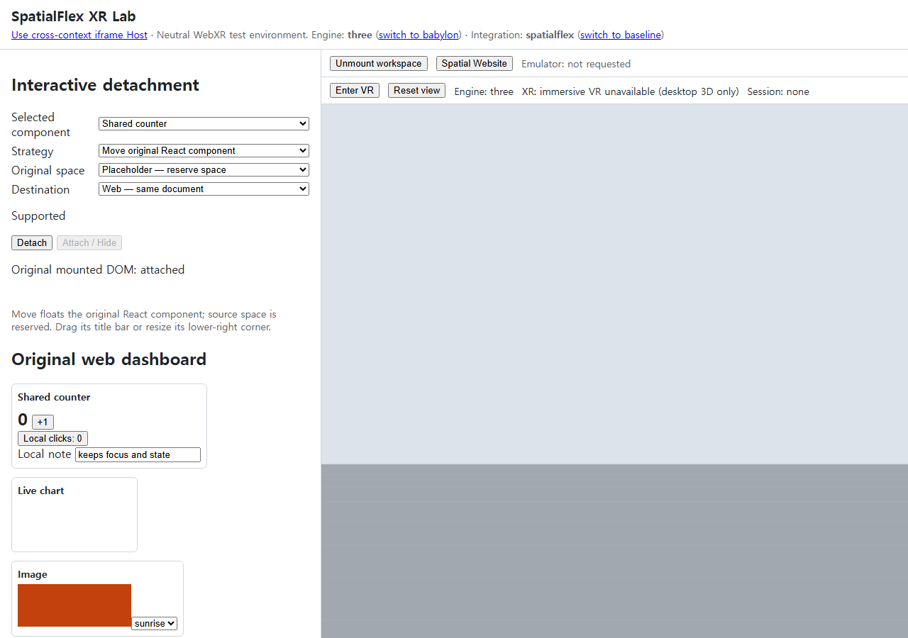
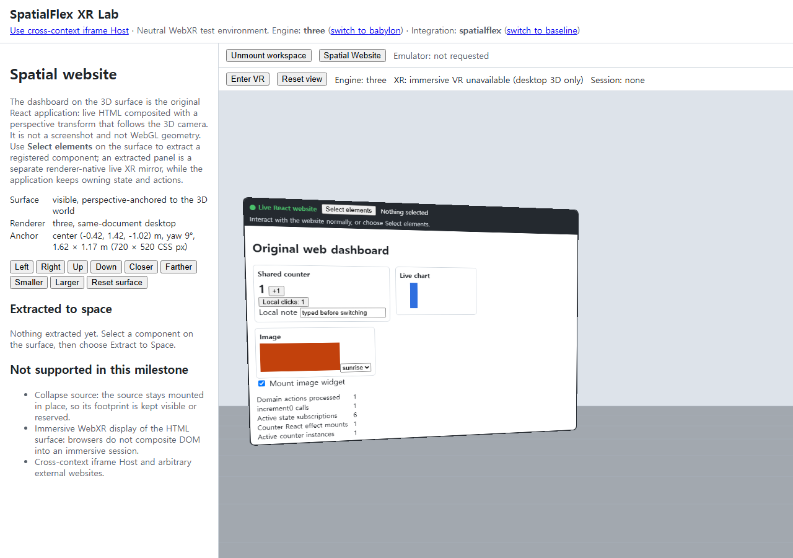
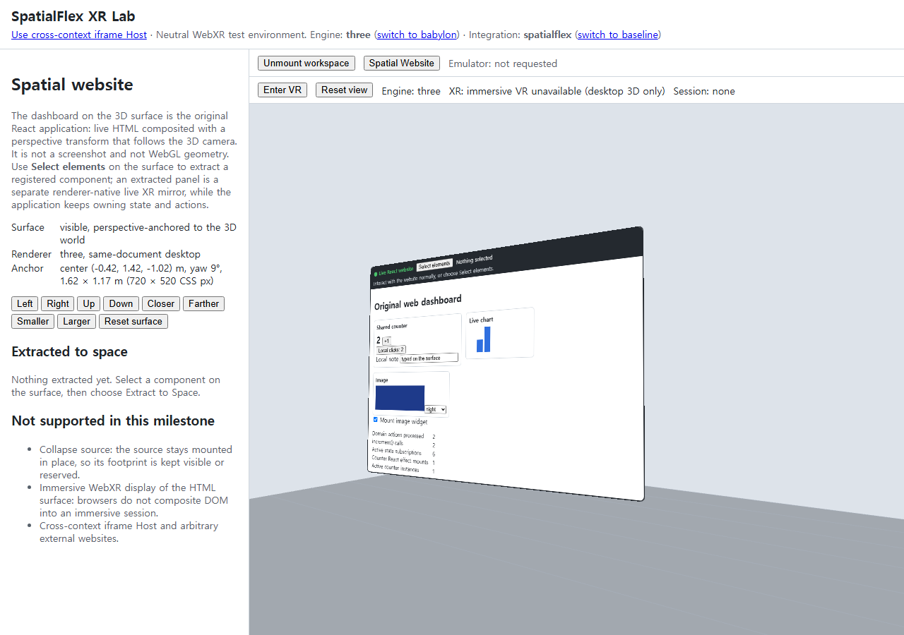
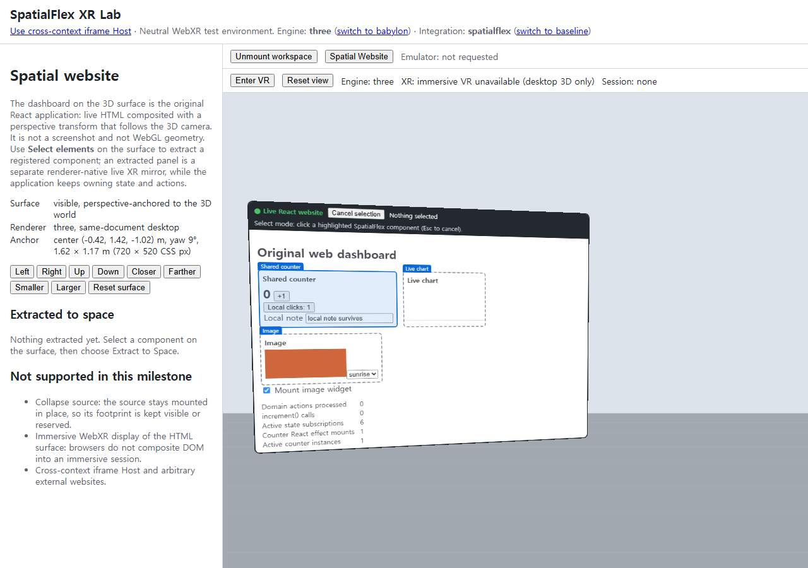
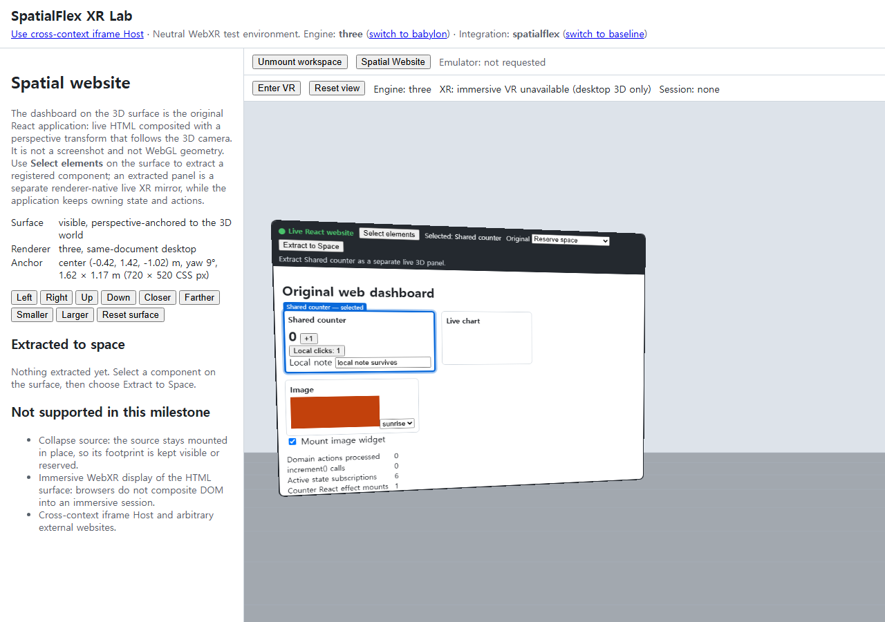
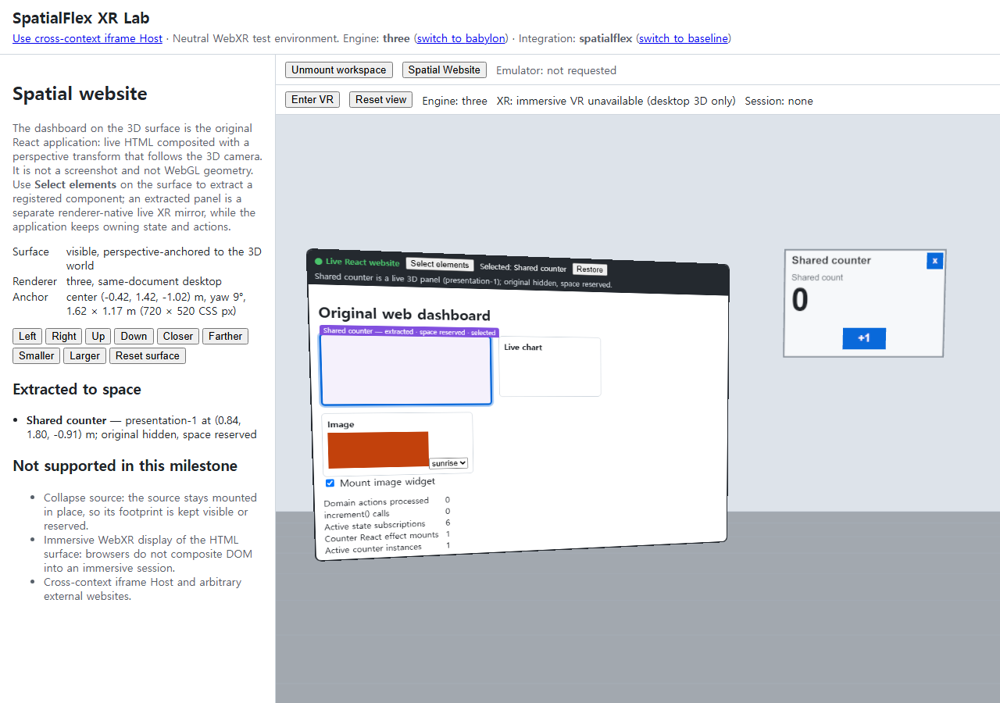
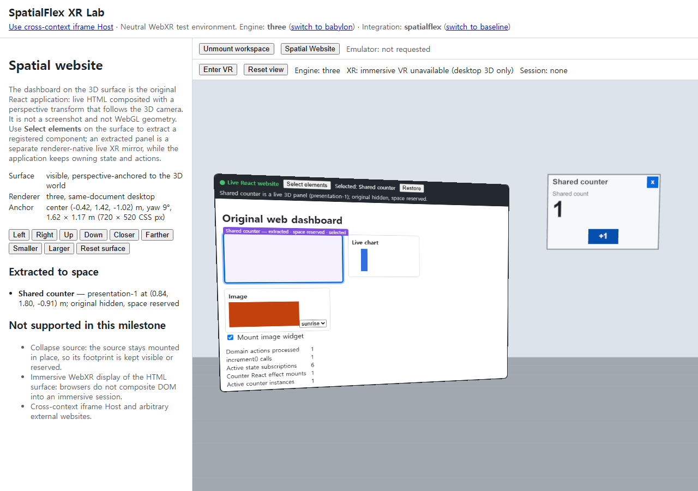

# P1-06 Spatial Web Surface & In-Surface Element Extraction

Status: **experimental, desktop proof of concept.** Issue [#22](https://github.com/ppsssj/SpatialFlex/issues/22).

A user opens one desktop URL and sees the real, interactive XR Lab React dashboard **anchored in the 3D world**. They can use its controls, select a registered component directly on that website, extract it as a separate live 3D panel, interact with the panel, and restore the original without losing application state.

Four different things appear in this demo, and they are not interchangeable:

| Term                          | What it is                                                                                                        | Who renders it                 |
| ----------------------------- | ----------------------------------------------------------------------------------------------------------------- | ------------------------------ |
| **Live HTML website surface** | The original React dashboard DOM, presented with a per-frame perspective CSS transform that matches the 3D camera | The browser's HTML compositor  |
| **Original React component**  | The mounted `SpatialItem` (Counter, Live Chart, Image) inside that website, with its local state                  | React DOM, unchanged           |
| **Extracted XR presentation** | A renderer-native panel built from the component's declared `SpatialItem xr` view (P1-04), the existing XR Mirror | Three.js or Babylon.js (WebGL) |
| **DOM Move** (P1-05)          | The original DOM floating within its own document                                                                 | React DOM, split mode only     |

Ordinary React DOM is **not** converted into WebGL geometry, and the surface is **not** a screenshot or texture.

## 1. Feasibility analysis and decision (ADR)

**Context.** The surface must show the existing, already-mounted dashboard (no second React root, no clone, no remount) with working native input, follow camera orbit, reset and resize, and work alongside the existing renderer-neutral Host contract for both engines.

| Candidate                                                                                            | Live React state and native events                                                                          | Fit with existing architecture                                                                      | Result                                           |
| ---------------------------------------------------------------------------------------------------- | ----------------------------------------------------------------------------------------------------------- | --------------------------------------------------------------------------------------------------- | ------------------------------------------------ |
| **A. CSS 3D / DOM compositing**                                                                      | Yes. The browser hit-tests transformed elements, so inputs, selects and focus work natively.                | Needs only the camera from the renderer.                                                            | **Chosen, as a minimal in-repo compositor**      |
| B1. Three.js `CSS3DRenderer`                                                                         | Yes, but it **re-parents** the element into its own container and applies CSS `perspective` per camera      | Moving React-owned DOM breaks React ownership. Three-only.                                          | Rejected                                         |
| B2. `@react-three/drei` `Html` (transform mode)                                                      | Renders children through a **separate React root**                                                          | Violates the requirement for no duplicate root or remount. Adds a dependency. Three-only.           | Rejected                                         |
| C. Babylon.js HTML surface (`@babylonjs/addons` `HtmlMeshRenderer`)                                  | Same CSS 3D principle, but also moves the element into its own overlay container                            | Babylon-only, and gives a second state and positioning model. Babylon GUI is canvas-drawn, not DOM. | Rejected                                         |
| D. DOM → texture (html2canvas-style rasterization, SVG `foreignObject`, experimental HTML-in-canvas) | Static images. No real event delivery, focus or text input. The experimental API is unavailable in Firefox. | Would need synthetic event re-dispatch                                                              | Rejected: static textures do not meet acceptance |

**Decision.** A renderer-neutral contract plus a small DOM compositor:

1. Each Host publishes its final desktop camera per rendered frame as plain numbers: `onCameraFrame({ viewProjection, viewport, eye })` (`HostCameraFrame` in [`contracts/xrHost.ts`](../apps/xr-lab/src/contracts/xrHost.ts)). Three.js reports `projectionMatrix × matrixWorldInverse`. Babylon.js reports `scene.getTransformMatrix()` (right-handed scene, same memory layout). A Host opts in with `webSurface: true`.
2. The **DOM compositor** ([`surface/`](../apps/xr-lab/src/surface)) owns world-to-screen alignment. It computes the exact planar homography `page px → viewport px` for the surface pose and writes it as one CSS `matrix3d` with `transform-origin: 0 0`. The browser performs the perspective division, so the page and the WebGL scene share one projection. Hit testing also follows the transformed quad. Writes happen per frame, outside React, and only when the value changes.
3. The page element stays at its React position. The wrapper elements around `<Dashboard>` are identical in both modes, so switching modes **never remounts** the dashboard. Only styles and attributes change.

**Consequences.** The same contract and compositor serve Three.js and Babylon.js. Engines never touch the DOM. The iframe Host cannot provide a same-realm camera callback, so the mode is **explicitly unsupported** there (see §4).

## 2. Architecture and ownership

| Layer                                      | Owns                                                                                                                                                                                                           |
| ------------------------------------------ | -------------------------------------------------------------------------------------------------------------------------------------------------------------------------------------------------------------- |
| Application (XR Lab fixture)               | React state, domain store, business actions, component lifecycle                                                                                                                                               |
| SpatialFlex Core                           | Registration identity, strategy validation, the **source visibility** contract (`SourceVisibility`, `validateSourceVisibility`), presentation metadata (`record.layout.visible`)                               |
| SpatialFlex React                          | Applying source visibility to the mounted `SpatialItem` (`visibility: hidden` + `inert`, footprint kept), `controller.setSourceVisibility`, read-only `controller.sourceElement(id)` for registered items only |
| DOM compositor (`apps/xr-lab/src/surface`) | Surface presentation, camera alignment, occlusion clipping, pointer routing, selection outlines                                                                                                                |
| XR renderer (Three.js / Babylon.js Hosts)  | 3D panel geometry, rendering, raycasting, panel interaction. It publishes camera frames only.                                                                                                                  |
| Bridge (P1-03)                             | Unchanged: serialization, session, message and action validation, revisions, stale rejection                                                                                                                   |

No store is duplicated. The 3D panel reads the same parent-realm registry views as every P1-04/P1-05 mirror. Its actions pass through the same `currentPresentation` ownership guard (registration + presentation instance) as before.

### World-to-screen transform

```ts
interface SpatialWebSurfacePose {
  position: readonly [number, number, number]; // center, meters
  rotation: readonly [number, number, number]; // XYZ Euler, radians
  width: number; // meters
  height: number; // meters
}
// Default: position [-0.42, 1.42, -1.02], yaw 0.15 rad, 1.62 × 1.17 m,
// page layout viewport 720 × 520 CSS px.
```

The `surfaceTransform(frame, pose, resolution)` and `occlusionClipPath(...)` functions in [`surfaceMath.ts`](../apps/xr-lab/src/surface/surfaceMath.ts) are pure. Unit tests check them against Three.js's own `Vector3.project` for several camera positions.

### Occlusion and pointer routing

The HTML layer is composited above the canvas, so depth is handled explicitly:

- **3D rectangles in front of the surface plane** are cut out of the page with an even-odd `clip-path` polygon, computed through the inverse homography. The panel shows through, and pointer input in the hole reaches the canvas, so the panel stays clickable.
- **Rectangles behind the plane** remain covered by the page, as in a depth-tested scene.
- The fixed layer covers exactly the canvas rectangle with `pointer-events: none`. Only the page takes input, so orbit drags elsewhere on the canvas reach the camera controls, and wheel input over the page scrolls the website.
- The surface is hidden, with a status message, when viewed from behind or when it crosses the camera plane.

### Source visibility (separate from P1-05 strategies)

The P1-05 `DetachmentStrategy` matrix is unchanged (`mirror + placeholder + xr` is still rejected). Extraction uses a separate policy:

| Policy                       | Behavior                                                                                                                                                                           | Status                                                          |
| ---------------------------- | ---------------------------------------------------------------------------------------------------------------------------------------------------------------------------------- | --------------------------------------------------------------- |
| `visible` — _Keep original_  | Original stays visible and interactive. A live XR Mirror appears.                                                                                                                  | Supported (P1-05 Mirror)                                        |
| `reserved` — _Reserve space_ | Original is hidden (`visibility: hidden`, `inert`, `aria-hidden`) but stays **mounted in place**, so its footprint, local state and field values persist. The XR panel stays live. | Supported                                                       |
| `collapsed`                  | Would need the hidden source to give up its layout box                                                                                                                             | **Rejected with a reason** (not demonstrated in this milestone) |

Restore, the 3D close control, P1-05 Move, unmount and remount all present the original again: moving a reserved source shows it, and a new registration always starts `visible`. A hidden source plus a live mirror is **not** a transfer of the original DOM into WebXR.

### Selection inside the surface

Selection uses an explicit mode (**Select elements** in the surface's own toolbar). In that mode the page content is `inert`, and the only clickable targets are outline buttons for **registered SpatialFlex components**. These come from `useSpatialItems()` records and `controller.sourceElement(id)`, with no CSS selectors and no per-app table, so a new registered widget participates automatically. Outline geometry uses untransformed layout offsets, so it moves with the page. Components without a declared `xr` view are outlined as _unsupported_ and cannot be extracted. Clicking unregistered content selects nothing. Keyboard: entering selection mode with Enter or Space focuses the first component, Tab moves between components, Enter picks one and moves focus to **Extract to Space**, and Escape leaves the mode. Outside selection mode no overlay intercepts input.

Visual states (CSS-distinct, also exposed as attributes): `data-hovered`, `data-selected`, `data-extracted="visible|reserved"`, `data-unsupported`.

### Placement

`extractionPosition(pose, index, PANEL_SIZE)` places the _n_-th extracted panel beside the surface's right edge, 0.3 m toward the viewer, stacked from the top. The panel is a world-space object in front of the plane, so it neither overlaps the surface initially nor hides behind it. Existing XR panel controls (`+1`, `Next`, close `x`) are reused. Dragging panels in space is deferred.

## 3. Demo

```bash
pnpm install --frozen-lockfile
pnpm --filter @spatialflex/xr-lab dev --host 127.0.0.1 --port 5173 --strictPort
```

Open **http://127.0.0.1:5173/?integration=spatialflex&engine=three&bridge=off&surface=website**. Use `engine=babylon` for Babylon.js. Without `surface=website`, the **Spatial Website** button in the workspace bar switches modes without reloading. All earlier URLs behave as before.

1. The live dashboard appears on a dark-framed surface marked **● Live React website**. Click `+1`, type in _Local note_, and change the Image select. These are the real controls.
2. Drag the floor of the 3D view to orbit. The website keeps its world position in perspective. Use **Reset view**, resize the window, or use the inspector's **Move surface** and **Larger/Smaller** buttons.
3. Click **Select elements**, hover a widget (blue outline), and click it (selected).
4. Choose **Original: Reserve space** (or _Keep original_) and click **Extract to Space**. A separate 3D panel appears to the right. The original's place stays reserved and outlined in purple.
5. Click the 3D **+1**. The application count increments exactly once and the Live Chart updates.
6. Click **Restore** (or the panel's `x`). The original component returns with its local note and click count.
7. Repeat with **Live chart** (no actions, live bars) and **Image** (3D **Next** changes the app's image).

## 4. Capability matrix

| Engine     | Same-context desktop | Cross-context iframe           | Immersive WebXR                                                         |
| ---------- | -------------------- | ------------------------------ | ----------------------------------------------------------------------- |
| Three.js   | **Supported**        | Unsupported, with reason in UI | HTML surface not shown (browser limitation); XR Mirror panels unchanged |
| Babylon.js | **Supported**        | Unsupported, with reason in UI | Same as Three.js                                                        |

The baseline integration is unsupported, with a reason (no SpatialFlex registrations). Existing iframe XR Mirror behavior is unchanged and still covered by the P1-03/P1-05 suites.

## 5. Evidence

Screenshots (Three.js, Chromium, 1280×900, from `e2e/surface.spec.ts`):

|                                                       |                                            |
| ----------------------------------------------------- | ------------------------------------------ |
| Original split XR Lab                                 |          |
| Whole live website on the spatial surface             |      |
| Angled camera: perspective-anchored, not a 2D overlay |        |
| Hover outline in selection mode                       |          |
| Selected Counter                                      |    |
| Counter extracted, original space reserved            |  |
| Shared state updated from the 3D panel                |      |
| Restored original component                           |    |

The flow records are in `evidence/p1-06-{three,babylon}-{chromium,firefox}.json`.

**What the browser tests assert** (`apps/xr-lab/e2e/surface.spec.ts`, real mouse and keyboard input only):

- **Anchoring:** the four DOM corners of the composited page lie within 2 px of where the renderer's own camera projects the pose's world corners. This holds at the default view, after orbit, after Reset view, after two viewport resizes, and after pose moves and scaling. After orbit the left and right edges differ in length (a perspective, non-affine projection).
- **Mode switching** keeps the same DOM node, input value, local state, React mount count, instance count and subscription counters.
- **Native controls** on the transformed page work: button, text input (keyboard), select.
- **Selection:** hover and selected states, registered components only, inert content in selection mode, the full keyboard path (toggle → first component → Tab → Enter → Extract → Restore), Escape, and Collapse disabled.
- **Extraction:** the panel is in front of the plane and right of the surface on screen. Reserve keeps the source and neighbor layout geometry identical. The 3D `+1` produces exactly one domain action, and the chart and image mirrors stay synchronized. Restore returns the local state, and mounts and subscriptions are unchanged.
- **Occlusion:** a panel in front of an overlapping surface is hit-tested as the canvas and stays clickable. After moving the surface in front, the page covers it.
- **Lifecycle:** unmounting the extracted Image removes its presentation and selection. Remounting gives a fresh visible registration and a new presentation id. A press held across Restore → Extract cannot act on the new panel. Repeated cycles leave textures, subscriptions and instances unchanged. Unmounting the workspace shows the website in place.
- **Unsupported:** iframe and baseline disable the mode with a reason, and the XR Mirror still works.

Validation totals for the PR head are recorded in the PR description.

## 6. Known limitations

- **CSS3D, not WebGL.** The page is drawn by the browser compositor above the canvas. Depth is approximated by planar rectangle cut-outs: intersecting geometry, non-rectangular meshes and overlapping cut-outs (even-odd) are not depth-correct. Text is rasterized at the projected scale, so it can be soft when small.
- **No immersive display.** Browsers do not composite DOM into an immersive WebXR session, so the surface is desktop-only. A physical headset has not been tested.
- **Same document only.** There is no iframe Host, no cross-origin pages and no arbitrary external websites. The target is an application integrated with SpatialFlex.
- P1-05 DOM Move is not offered on the surface: moved components are attached when entering the mode, because `position: fixed` inside a transformed ancestor is captured by it.
- One surface. Extracted panels are not draggable in space yet, and their placement is fixed at extraction time.
- `collapsed` source visibility is rejected.

## 7. Next steps

1. Depth-correct mixing: render the canvas above the DOM with a transparent depth "hole" for the surface, and route pointer input by raycast.
2. Spatial manipulation of extracted panels (grab and move) and of the surface itself.
3. An iframe-capable surface: the Host posts camera frames over the validated bridge, and the parent composites over the iframe.
4. An immersive path: a texture-based surface only once DOM-in-canvas APIs provide real event delivery, or declared XR views for all content.
5. Collapse policy with reflow evidence, multiple surfaces, and persistence of poses and extractions.
